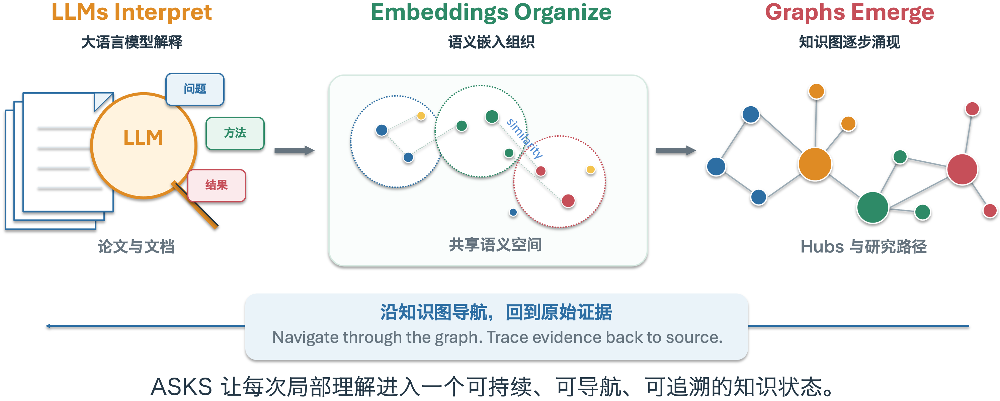
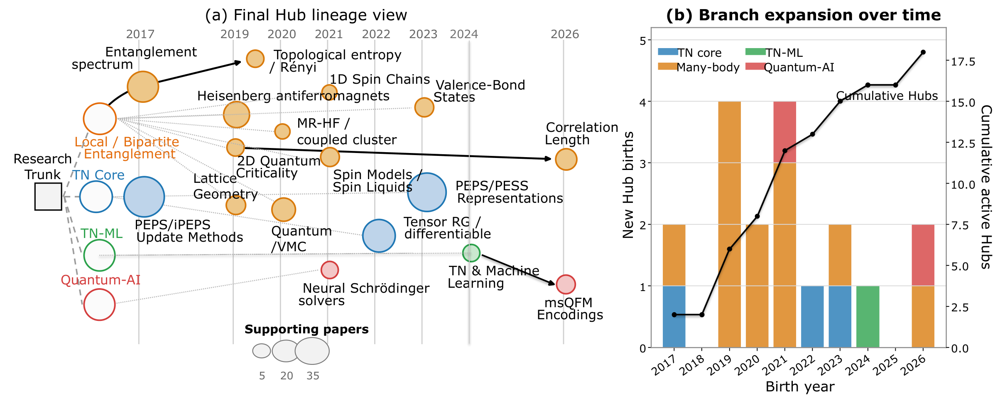

# ASKS 智能知识系统

> **Agent-Driven Scientific Knowledge System**
>
> 让 AI 持续积累、组织和使用知识
>
> *LLMs Interpret, Embeddings Organize, Graphs Emerge*

面向一般读者的项目介绍。本文说明 ASKS（Agent-Driven Scientific Knowledge System，智能体驱动的科学知识系统）如何把分散的论文、文档和研究记录编译成可阅读、可导航、可追溯来源的持续知识系统。

**公开入口：** [GitHub 仓库](https://github.com/ranshiju/Ran-ASKS) | [arXiv:2608.29612](https://arxiv.org/abs/2608.29612) | [下载 PDF 版](ASKS-Chinese-Introduction-2026-09-03.pdf) | [版本对应关系](README.md)

项目中文介绍，2026年9月3日发布，2026年10月10日同步至 Ran-ASKS v0.15.0。本页是 GitHub 在线阅读版，PDF 保留已审阅页面并追加工程更新，用于下载和打印。

## 目录

- [摘要](#摘要)
- [快速使用](#快速使用)
- [AI 读过，不等于知识真正积累下来](#ai-读过不等于知识真正积累下来)
- [先用三句话认识 ASKS](#先用三句话认识-asks)
- [1. 大语言模型解释，语义嵌入组织，知识图涌现](#1-llms-interpret-embeddings-organize-graphs-emerge大语言模型解释语义嵌入组织知识图涌现)
- [2. Raw、Wiki 和 Graph](#2-rawwiki-和-graph)
- [3. Graph 如何涌现](#3-graph-如何涌现)
- [4. 面向持续工作的系统工程](#4-面向持续工作的系统工程)
- [5. 从 56 篇论文到研究肖像](#5-从-56-篇论文到研究肖像)
- [结语](#结语)
- [参考文献](#参考文献)
- [参考的开源项目](#参考的开源项目)

## 摘要

ASKS 是一个面向持续知识工作的科学知识系统。它保存论文、会议纪要和普通文档来源，由按来源类型适配的编译器形成可阅读的 Wiki 与来源局部语义，再把所有文档统一编译为可验证的知识 IR 和图计划，经唯一事务性写图器接入持续演化的知识图。会议纪要由同一个 Meeting Compiler 完成口语文本整理、Wiki 编译和语义槽抽取。Wiki 与 Graph 帮助研究者和 Agent 查找概念、论文、主题分支和研究轨迹，重要事实则沿来源链接返回 Raw 中保存的证据。系统同时提供断点续做、失败槽位局部恢复、请求诊断、工程元图和受守卫的 Agent 工具调用。详细方法与实验见已公开论文\[1\]。

## 快速使用

ASKS 可以在具有本地文件访问、命令执行和工具调用能力的 Agent 平台中使用。Codex 和 WorkBuddy 是可选平台示例，具体接入方式随平台而异。ASKS 的共同入口是项目文件、环境配置与 AGENTS.md 中的操作边界。

| **步骤** | **操作** | **说明** |
|:--:|----|----|
| **1** | **打开项目** | 从 GitHub 下载或克隆仓库，在支持本地文件和工具调用的 Agent 平台中打开，例如 Codex 或 WorkBuddy。 |
| **2** | **配置模型服务** | 参照 .env.example 配置主 LLM 与 Embedding。INGEST_BACKEND 独立选择摄入编排；API 模式可用 INGEST_GENERATION\_\* 和 INGEST_PROPOSITION\_\* 分别配置生成与命题抽取模型，未设置时复用主 LLM。 |
| **3** | **让 Agent 读取规则** | 先让 Agent 读取项目根目录的 AGENTS.md，再用自然语言提出摄入、查询、研究或系统建设任务。 |

> **配置与安全**
>
> Embedding 服务可以与 LLM 共用 API 地址和密钥，也可以独立配置。真实 API 密钥只写入本机环境或未纳入版本控制的 `.env`，不应写入文档、代码、日志或提交到 GitHub。

## AI 读过，不等于知识真正积累下来

今天让 AI 读一篇论文并不难。把 PDF 放进对话框，它很快就能给出摘要、解释公式、回答问题。这个过程很容易让人觉得，只要不断把论文交给 AI，知识就会自然积累起来。

当材料从一篇变成几十篇、几百篇，甚至跨越数年的研究记录时，问题就变了。每次对话里的“读懂”通常停留在当次上下文中。AI 未必知道一篇新论文与过去哪些概念相连，哪些内容提供了新证据，哪些只是已有结论的另一种表达，也不会自动形成一张持续更新的整体知识地图。

如果每次开始新任务都重新上传材料、重新解释背景，系统就会一遍遍消耗 Token、时间和费用。更长的上下文可以容纳更多内容，却更像一次性的工作台。会话结束、模型更换或 Agent 平台变化后，之前形成的理解往往难以直接继承。读过很多次，并不等于知识已经被稳定保存、组织和复用。

还有一个更实际的问题。AI 给出的答案可能听起来很完整，研究者仍然需要知道它依据哪篇论文、哪一段原文。缺少清晰的来源路径时，原始事实、模型概括和进一步推断容易混在一起。材料越多，这种混淆越难检查。

ASKS 处理的正是这一层长期问题。它让 LLM 解释单个来源，把结果保存为可阅读的 Wiki 与局部语义，再用 Embedding 和明确规则把新知识接入持续演化的 Graph，同时保留返回 Raw 证据的路径。这样，AI 的每次阅读不再只服务于一次对话，而会成为可积累、可导航、可复查的知识状态。

## 先用三句话认识 ASKS

论文、文档和研究记录不断增加时，真正需要积累的不只是文件数量，还包括对概念、方法、关系和来源的持续理解。跨文献连接知识是一个长期问题\[2\]。ASKS 将每份材料编译成能够被人和 Agent 继续使用的知识状态。

| 持续积累 | 结构导航 | 证据可追溯 |
| --- | --- | --- |
| 每份材料形成可继承的知识状态，后续工作能够从已有理解继续。 | Wiki 和 Graph 组织跨文档知识，其中 Graph 主要负责关联和导航。 | 重要事实沿 Wiki 和 Graph 返回 Raw 中保存的原始材料。 |

> **一句话定义**
>
> ASKS 是一个以来源证据为基础、以 Wiki 和 Graph 为知识结构、支持人和 Agent 持续工作的知识系统。

## 1. LLMs Interpret, Embeddings Organize, Graphs Emerge：大语言模型解释，语义嵌入组织，知识图涌现

这句话概括了 ASKS 中三种彼此配合的计算角色。它们不是三个孤立模块，而是同一知识编译过程在不同阶段承担的分工。

| **计算角色** | **主要输入** | **主要作用** | **形成的结果** |
|----|----|----|----|
| LLM | 当前来源 | 理解语言、提炼局部语义 | Wiki 内容与语义槽 |
| Embedding | 局部语义与已有知识 | 提供共享语义空间 | 相似度、候选关系与组织依据 |
| Graph 规则 | 局部变化与已有图状态 | 执行身份、成员和生命周期规则 | 新的持久图状态 |

### LLMs Interpret：大语言模型负责理解

论文、会议纪要和普通文档首先是写给人看的。它们包含自然语言、公式、图表、术语或口语上下文。大语言模型负责理解当前来源，将材料转化为可阅读的 Wiki 内容和机器能够继续处理的局部语义。会议纪要由同一个 Meeting Compiler 在一次任务中完成口语文本整理、Wiki 编译与语义槽抽取，避免多个执行者重复读取同一份长文本。

不同来源仍使用各自适合的预处理和提示词，但 LLM 输出都会经过结构与语义校验，并编译为统一的知识 IR 和确定性图计划。LLM 负责解释材料，不直接写 Raw、Wiki 或 graph.db，也不会凭一次调用决定整个知识库的最终结构。

### Embeddings Organize：语义嵌入负责组织

Embedding 可以把一段文字或一个知识节点表示为语义空间中的位置。概念越接近，它们在这个空间中通常也越接近。句子级 Embedding 为这种可复用的语义比较提供了成熟方法\[4\]。ASKS 使用共享的 Embedding 空间比较新知识与已有知识，支持节点复用、关系候选、Hub 归属和跨文档组织。

这种分工把大量重复比较交给可批处理、可缓存的数值层。不同 Agent 平台可以在同一个语义组织基础上工作，开放式模型判断则保留给来源理解和高影响语义审查。

### Graphs Emerge：知识图逐步形成

ASKS 中的图不是由某个模型一次性完整绘制出来的。每份新材料只提出一组局部变化。局部变化与已有图状态反复相互作用，主题区域、Hub、分支和研究轨迹由此逐渐形成。

这里的“涌现”指一种可观察的构建过程。系统能够记录哪些来源进入、哪些节点被复用、哪些关系被建立、Hub 在何时出现，以及成员后来如何变化。

## 2. Raw、Wiki 和 Graph

上一节介绍的是计算过程中的角色。本节介绍 ASKS 长期保存和使用的三类信息。它们共同组成知识系统，但承担不同职责。来源保存、来源关系和可复用研究产物的设计参考了 FAIR、PROV-DM 与 RO-Crate 的基本思想\[5-7\]。

| **层** | **保存什么** | **主要读者** | **在事实判断中的角色** |
|----|----|----|----|
| **Raw** | 原始论文、文档、元数据与可定位派生内容 | 人、工具和证据核验流程 | 事实依据 |
| **Wiki** | 面向阅读的解释、摘要、概念和来源链接 | 研究者与语言模型 | 连接原始材料与知识结构 |
| **Graph** | 跨来源节点、关系、Hub、成员与演化记录 | 检索工具、Agent 与分析程序 | 组织知识并引导导航 |

### Wiki：把单份来源变成可阅读知识

Wiki 是面向人和语言模型的编译阅读层。它不只是论文摘要，还可以组织核心问题、方法、概念、结论、局限和来源定位。读者先通过 Wiki 快速理解一份材料，再按需要返回 Raw 核验原文。Wiki 因此连接了保存下来的原始材料与跨来源知识结构。文档与机器可处理语义结合的早期代表包括 Semantic MediaWiki\[8\]。

### Graph：把跨来源关系变成导航结构

Graph 是面向计算和导航的关系层。它记录可复用节点、跨来源关系、Hub、成员归属和演化谱系，使检索工具和 Agent 能够从一个概念进入相关方法、论文与主题区域。知识图的通用方法为这种机器可操作的关系表示提供了基础\[3\]。在 ASKS 中，Graph 的价值主要体现在知识结构和导航质量。它可以保留一定近似性，并通过来源链接、构建记录和后续重编译持续修订。

> **核心边界**
>
> Raw 保存证据，Wiki 承载理解，Graph 组织知识并引导查找。Graph 的任务是帮助用户找到相关内容，事实判断回到原始来源。

这一结构让系统同时面向人和机器。研究者可以阅读 Wiki，程序可以计算 Graph，重要结论则可以沿来源链接返回 Raw。Wiki 和 Graph 都是可修订的编译结果，因此系统能够在保留原始材料的同时更新组织方式。

不同的 Graph 可以像不同图书管理员整理出的书架。分区方式可能不同，但只要它们能够把用户引向相近的相关论文和原始证据，就仍然具有良好的导航价值。ASKS 因此把 Graph 定位为可演化的知识地图，而不是唯一正确的学科分类表。

## 3. Graph 如何涌现

ASKS 将论文、会议纪要或普通文档的一次摄入看作一次从来源到知识状态的编译。不同类型可以保留不同的预处理与提示词，但落图共享同一份中间表示、图计划和事务写入机制。

> **统一编译链路**
>
> 科学材料 -> LLM 解释 -> 验证 GraphDelta -> Embedding 与规则 -> 持续知识状态与来源导航

### 从局部解释到全局结构

第一步，系统保留收到的论文、会议纪要或普通文档，并为其建立稳定的来源标识。第二步，按来源类型适配的编译器生成可阅读 Wiki 和局部语义槽；会议纪要的口语整理、Wiki 与语义槽由单一 Meeting Compiler 一次完成。第三步，校验器把局部输出编译为版本化 Knowledge IR，再生成绑定其哈希的确定性 graph plan。第四步，唯一写图器根据文字证据、Embedding 与明确规则，决定节点复用、创建、关系、来源和 Hub 归属，并以事务方式提交。

图计划通过事务写入后，受影响的节点会重新计算 Hub 归属。若校验失败，系统只把精确错误交给原编译器定向修订，或由受限语义恢复处理失败槽位，同时记录请求诊断，不会静默重跑整条摄入事务。已有主题可以继续吸收知识，尚未被良好覆盖的语义区域可以形成新 Hub。随着材料持续进入，Hub 会扩张并形成可追踪的分支和谱系。

### 三个结构尺度

在节点尺度，系统判断一个新概念是否对应已有知识。在 Hub 尺度，系统判断节点属于哪些主题区域。在时间和层级尺度，系统记录主题何时形成、怎样扩张以及如何连接到已有分支。作者研究肖像、领域发展路径和跨主题导航都建立在这些可追踪变化之上。

> **什么是 Hub**
>
> Hub 是知识图中的持久导航区域，代表积累知识空间中一个相对连贯的部分。Hub 帮助人和 Agent 决定从哪里开始阅读，其成员和边界可以随着知识增长继续修订。

## 4. 面向持续工作的系统工程

持续知识系统需要面对多类型材料、长时间运行、模型变化、批量摄入、失败恢复和多人使用。ASKS 把这些工程要求纳入知识架构，使每次变化都具有明确边界。

| **工程特点** | **对持续知识工作的意义** |
|----|----|
| **来源与派生知识分离** | 原始材料保持稳定，Wiki 和 Graph 可以在明确边界内重新编译。 |
| **写入前验证** | LLM 输出先形成局部语义和可检查变化，通过契约后再进入持久状态。 |
| **文档级事务与回滚** | 一次摄入形成完整事务，硬约束失败时不会留下半完成图状态。 |
| **断点续做** | 长时间摄入、批量重建和外部审计能够从有效检查点恢复。 |
| **重放与版本边界** | 来源、模型、Embedding、规则、阈值和调用顺序可以被冻结并重新执行。 |
| **来源与构建记录** | 节点、关系、Hub 和肖像指标能够追溯到支持它们的论文和构建步骤。 |
| **Agent 分层调用** | 持续工作、按需能力和参数化工具彼此分离，Agent 只在需要时加载相应功能。 |
| **显式远程生成** | 漫画图片只通过登记模型、明确输出目录和逐次远程授权生成，并保留可审计回执。 |

> **持续工作与状态**
>
> 自2026年10月20日起，可跨操作和会话接续推进的工作统一称为“持续工作”，工程上称为“工作上下文”；“状态”用于具体生命周期或执行进度。持续工作保存目标、约束、决策、成果与待办，功能则完成有边界的操作。既有 `state` / `states` 字段、类型 ID、命令参数与存储路径保持兼容；后文按日期保留的历史更新说明可能沿用旧称。

### 统一摄入、局部恢复与模型分工

论文、会议纪要和普通文档可以使用不同的语义协议，但校验后的语义统一进入 Knowledge IR、确定性 graph plan 和唯一事务性写图器。按来源保存的描述与来源关系参与身份匹配、导航、清理和 Hub 维护。Agent backend 由当前宿主 Agent 持有控制循环，脚本只提供 `agent-task-v1`、暂存输出、机械校验和事务提交；API backend 由程序通过 DSH 与受限 Worker 推进。两端共享确定性内核，不共享语义执行 adapter。具有会议速记特征的办公文档保留语音识别来源；部门与负责人关系必须由原文明示。

摄入编排由独立的 INGEST_BACKEND 选择。API 模式还可以通过 INGEST_GENERATION\_\* 和 INGEST_PROPOSITION\_\* 分别指定生成与命题抽取模型；未配置时复用主 LLM。无论语义由当前 Agent 还是 API Worker 完成，持久化都只由共享 validator 和统一事务写入机制控制。

### 工程元图：先确定影响面，再修改系统

科学知识图描述论文、概念和研究关系，工程元图则描述 ASKS 自身。operations/engineering/graph.yaml 把组件、契约、能力和验证关系组织成一张可查询的工程地图。Agent 在建设功能前先运行 engineering_graph.py 的 impact 检查，确定目标会影响哪些组件，以及需要执行哪些最小验证。对于高风险组件，还可以读取简短的输入、输出和写入边界契约。

工程定位器随后按 Markdown 标题、YAML 指针、Python 符号或明确行段读取所需内容。这样，Agent 可以先理解相关局部结构，再修改代码和执行回归。工程元图并不保存科学事实，它的作用是让系统建设本身也具备影响分析、契约边界和可检查的验证路径。

> **两张不同的图**
>
> 科学知识图帮助研究者在知识中导航，工程元图帮助 Agent 在系统组件、契约和验证关系中导航。前者服务科学知识，后者服务系统建设。

### 状态、能力和工具

ASKS 还区分三种 Agent 调用机制。状态表示一项持续工作处于什么上下文，例如研究、摄入或建设。能力表示 Agent 在特定时刻需要加载的行为约定，例如只有真正落笔时才加载写作能力。工具是具有明确参数和结构化返回值的执行函数，例如查询关系、读取来源或更新研究记忆。

这种分层减少了 Agent 每次工作需要携带的上下文，也让调用边界更清楚。知识底座保持持续，具体能力按需进入，工具负责可检查的执行。

### 持久任务接力、私有隔离与可复用演示文稿

Agent 模式准备好的摄入事务现在可以通过 transaction ID 跨宿主会话接续。宿主先用
`wg.py task inspect` 读取类型化任务、声明的输入输出与下一步动作，再在必需输出存在后
用 `wg.py task advance` 执行原事务声明的检查、恢复或提交。任务记录不复制来源正文，
暂存回执也不替代 Raw、Wiki 或 graph.db 中的事实与导航状态。

私有知识采用独立 Raw／Wiki 目录和 `private/graph.db`，私有摄入、查询、索引与回执均
保持物理隔离。它们复用来源寻址和确定性校验，但不会把私有节点并入公共域图。公开仓库
只包含通用隔离实现和合成测试，不包含用户的私有知识、数据库或本机状态。

原生演示文稿处理进一步拆分为确定性结构提取与绑定来源的视觉识读：结构层保存文字、
表格、对象和位置，视觉层核对页面呈现和非文本信息。可复用幻灯片组件保留来源 deck、
可编辑性、布局 profile 与回执，项目图稿通过受管的可编辑矢量路径生成；任何远程调用
仍需显式授权。环境配置还允许用 `LLM_API_PATH` 与 `EMBED_API_PATH` 分别指定 Chat 和
Embedding 路径，适配不同兼容服务而无需修改代码。

这些能力构成2026年9月26日的 `v0.8.0` 兼容更新，不改变论文实验、冻结数据产物或复现
边界，也不自动创建标签或 Release。

### 从已提交源快照生成可复现的公开版本

公开版本不再直接依赖当前工作树。发布编排器首先确认 manifest 选中的源文件已经提交，
再从明确的 source commit 建立临时 worktree，生成并验证临时公开树。每个公开版本中的
`RELEASE_PROVENANCE.json` 记录源 commit／tree、manifest 哈希、版本、公开 payload
哈希和 PDF 渲染健康信息，使发布内容可以回到确定的工程来源。

临时树完整通过后才替换 `WikiGraph_clean` 的非 Git 内容；安装中途失败会恢复旧树。
提交与推送前还要核对公开仓库远端 URL、目标分支、工作树和 ahead／behind 状态。
推送必须显式授权，完成后以远端 commit 再确认；流程不使用 force push，也不自动创建
标签或 GitHub Release。

GitHub Actions 在 pull request 和 `main` 上重新执行发布边界、工程图、发布回归和冻结
论文产物校验。中文介绍 PDF 除人工对照编辑源外，还逐页机械检查文本可提取性、缺字
标记和非空渲染。从2026年9月26日的 `v0.9.0` 起，公开 Changelog 的更新内容和语义
版本判断同时使用英文与中文。本次兼容更新不改变论文实验或冻结数据产物边界。

### DSH：受守卫的 Agent 驾驶舱

DSH 是 ASKS 中可选的纯 Python Agent 驾驶舱。ToolRegistry 登记可以调用的工具，hook 流水线组织调用前、执行中和调用后的处理，guard 在真正执行前检查权限与边界，SessionLog 记录会话过程，AgentLoop 负责多步工具循环。DSH 借鉴 DeepSeek Harness 的插件化思想，并按照 ASKS 的数据边界独立实现。

查询、摄入、视觉检查、视觉对象化、漫画生成和工程定位分别通过不同的能力入口注册。漫画生成只允许已登记模型和明确的项目 `outputs/`，真实远程调用必须再次显式授权；它生成视觉素材和审计记录，不充当科学事实源。这样的分离让 Agent 能自动选择合适工具，同时避免把不相关的写入能力暴露给普通查询。DSH 只负责工具编排、守卫和会话记录。实际摄入、检索和图操作仍由底层脚本执行，科学事实仍保存在 Raw、Wiki 和 graph.db 所构成的知识底座中。

## 5. 从 56 篇论文到研究肖像

为了观察知识是否真的能够持续编译并形成全局结构，ASKS 对一个真实研究计划中的56篇正式发表论文进行了完整重建。每篇论文先独立形成来源局部解释，再按正式发表年份进入一个从空状态开始的隔离知识图。

### 知识能否持续积累并形成结构

完整运行形成18个最终 Hub，其中50篇论文能够映射到主要 Hub，6篇论文保留为明确的未映射状态。旧节点的 Hub 成员平均变动率约为0.47%，说明沿这一时间序列形成的主题组织保持低变动。节点复用、多来源支持、Hub 出生和谱系共同构成了一个可以回到具体论文的作者研究肖像。

图 1 由 56 篇正式发表论文编译得到的作者研究肖像。图中主题、出生年份、论文支持和谱系来自冻结图记录，宏观领域用于帮助阅读。

肖像显示出持续的张量网络方法核心，以及向量子多体研究、张量网络机器学习、量子计算和量子 AI 方向的扩展。它不是对研究者的主观评价，而是对论文支持、Hub 演化和图结构性质的来源可追溯描述。

### 形成的结构是否具有语义和导航意义

外部验证采用两类互补参照。APS 的 Physics Subject Headings 为部分物理论文提供稳定但覆盖有限的学科标签。它对概念层结构给出方向性一致信号。另一个盲法导航实验使用两个独立模型家族。模型只看到 Hub 标签和匿名论文标题、摘要，需要在真实支持论文和匹配对照之间做选择。

两个模型覆盖全部18个 Hub，成员识别的 Hub 宏平均为0.774，而随机参照为0.5。两个模型的主要得分接近。这个结果说明，外部模型能够从来源受限的论文证据中识别多数 Hub 的导航含义。模型不参与 Hub 构建，也不作为事实来源。

### 改变摄入顺序后会发生什么

顺序重建实验固定56份论文解释、Embedding、规则和参数，只改变同一年论文进入 Graph 的先后顺序。七组重建包括一次原顺序复现、一次同年逆序和五个同年随机顺序。原顺序能够精确复现冻结图的规范化结构。

六个扰动顺序最终形成18至21个 Hub。底层节点复用和多来源整合比例几乎不变，外部语义一致性也保持在相近范围。具体 Hub 成员的最佳匹配度为0.379至0.669，论文映射覆盖率为67.9%至83.9%，低于原顺序的89.3%。

这些结果显示，ASKS 在不同顺序下积累了相近规模和语义方向的知识，但中层主题边界会保留构建历史。Graph 的具体布局具有路径依赖，来源导航与宏观肖像是否保持等价则构成下一阶段的直接实验问题。

| **实验问题** | **主要观察** | **通俗含义** |
|----|----|----|
| 知识能否持续形成结构 | 56篇论文形成18个最终Hub，50篇论文进入最终研究树，旧节点成员平均变动率约为0.47%。 | 知识图能够沿真实时间序列逐渐形成低变动的主题结构。 |
| 结构是否具有语义和导航意义 | 两个独立模型在盲法成员识别任务中的Hub宏平均为0.774，随机参照为0.5。PhySH提供覆盖有限的方向性参照。 | 外部读者能够仅凭Hub标签和论文证据识别多数导航关系。 |
| 顺序改变后哪些性质保留 | 六个同年内扰动顺序产生18至21个Hub。底层复用与整合比例几乎不变，精确Hub成员匹配度为0.379至0.669。 | 系统积累了相近知识，但会形成不同的合理书架布局。 |

> **实验给出的整体认识**
>
> 低层知识编译具有较稳定的统计性质，宏观语义组织具有部分稳定性，具体 Hub 结构会受到构建路径影响。ASKS 以来源可追溯的导航价值评价 Graph，而不是要求每次构建得到唯一相同的树。

## 结语

ASKS 希望为人和 Agent 提供一个可以长期继承的知识基础。材料被局部理解，知识在共享语义空间中持续组织，Graph 随积累逐渐形成。研究者可以沿 Wiki 和 Graph 找到相关主题、论文和路径，并在需要事实判断时返回保存的来源证据。

这种架构适合个人长期研究、团队知识积累、跨文献调研、科研写作和科学 Agent 工作流。它把一次次独立的材料处理连接成连续知识状态，让后续工作真正建立在过去形成的理解之上。

## 参考文献

[1] S.-J. Ran, K. Zhang, X. Wu, L.-S. Yang, and W.-J. Li, “LLMs Interpret, Embeddings Organize, Graphs Emerge: Agent-Driven Compilation of Scientific Knowledge,” arXiv:2608.29612 (2026). [arXiv:2608.29612](https://arxiv.org/abs/2608.29612)

[2] D. R. Swanson, “Undiscovered Public Knowledge,” The Library Quarterly 56, 103-118 (1986). [doi:10.1086/601720](https://doi.org/10.1086/601720)

[3] A. Hogan et al., “Knowledge Graphs,” ACM Computing Surveys 54, Article 71 (2021). [doi:10.1145/3447772](https://doi.org/10.1145/3447772)

[4] N. Reimers and I. Gurevych, “Sentence-BERT: Sentence Embeddings using Siamese BERT-Networks,” EMNLP-IJCNLP, 3982-3992 (2019). [doi:10.18653/v1/D19-1410](https://doi.org/10.18653/v1/D19-1410)

[5] M. D. Wilkinson et al., “The FAIR Guiding Principles for scientific data management and stewardship,” Scientific Data 3, 160018 (2016). [doi:10.1038/sdata.2016.18](https://doi.org/10.1038/sdata.2016.18)

[6] L. Moreau and P. Missier, eds., “PROV-DM: The PROV Data Model,” W3C Recommendation (2013). [W3C PROV-DM](https://www.w3.org/TR/2013/REC-prov-dm-20130430/)

[7] S. Soiland-Reyes et al., “Packaging research artefacts with RO-Crate,” Data Science 5, 97-138 (2022). [doi:10.3233/DS-210053](https://doi.org/10.3233/DS-210053)

[8] M. Krötzsch, D. Vrandečić, M. Völkel, H. Haller, and R. Studer, “Semantic Wikipedia,” Journal of Web Semantics 5, 251-261 (2007). [doi:10.1016/j.websem.2007.09.001](https://doi.org/10.1016/j.websem.2007.09.001)

## 参考的开源项目

ASKS 同时使用或参考了若干开源项目。下表区分直接工具依赖、特定用途依赖和设计模式借鉴，并说明具体融合位置。项目当前代码、版本记录和各上游许可证是依赖关系的最终依据。

| **项目** | **参考层次** | **在 ASKS 中的关系** |
|----|----|----|
| [MinerU](https://github.com/opendatalab/MinerU) | **直接工具依赖** | 作为论文 PDF 的首选结构化提取引擎。56 篇论文冻结实验均使用 MinerU 产物。 |
| [DeepSeek Harness](https://github.com/deepseek-ai/deepseek-harness) | **设计思想借鉴** | 借鉴 Everything is a Plugin 的插件化工具、hook 和 guard 思路。DSH 为独立纯 Python 实现，不依赖 Cordis 运行时。 |
| [Semantica](https://github.com/semantica-agi/semantica) | **模式借鉴** | 参考声明式约束、来源记录和时间有效性模式，并适配到 ASKS 自身的图模式与单一图存储边界。 |
| [Docling](https://github.com/docling-project/docling) | **可选工具依赖** | 在用户明确选择较低优先级解析路径时提供本地文档解析，不替代冻结论文实验的 MinerU 提取边界。 |
| [PyMuPDF](https://github.com/pymupdf/PyMuPDF) | **特定用途依赖** | 用于 PDF 元数据读取、页面渲染、来源定位和视觉产物处理等确定性操作。 |
| [python-pptx](https://github.com/scanny/python-pptx) | **特定用途依赖** | 用于生成和处理对象可编辑的 PPTX 产物，包括视觉对象化工作流。 |

**项目资源：** [GitHub 仓库](https://github.com/ranshiju/Ran-ASKS) | [arXiv 论文](https://arxiv.org/abs/2608.29612)

## 2026年9月8日工程更新补充（v0.5.0）

本补充将图片文档摄入与复核机制归入 v0.5.0 新能力边界，不建立新的标签或 Release，不改变既有论文实验、冻结数据产物及其复现边界。PDF 保留原说明版式，并在末尾附上本补充内容。

### 图片也是一个可追溯的来源包

文字型图片通过独立 OCR 工具转写。原图和同名 Markdown 共同组成一个 Raw 来源：原图保留凭证，Markdown 支持检索与精确引用；配套元数据保存哈希、提取方式和复核记录，不成为第三份事实材料。已有识别回执可以复用，远程识别必须显式授权，模型可独立配置。

### 复核说明证据边界，不制造确定性

生成 Wiki 和图关系之前，先评估材料风险，逐项核对金额、编号、审批状态等关键字段。Agent 对照原图的复核与人工确认分别记录；关键字段未核对时阻止摄入。非关键不确定项可以随已完成来源保留，不自动产生用户待办。

例如，确认日期栏确实为空白，是有效的核对结论，不是要求用户补日期；有手写签名但未确认姓名时，可以保留原样而不建立具名负责人关系。摄入完成不代表原件事项已提交、获批或执行。Wiki 会保留 OCR 来源、复核状态和必要限制，而不把图片默认归为官方高可信材料。

### 同一确定性内核，两种控制方式

Agent 模式由当前宿主持有控制循环，API 模式由程序推进，二者共享提取校验、来源绑定、Wiki 与图校验和受管提交机制。原图、转写与来源元数据共同归档；只有最终校验通过并持久化完成状态后，才清理 inbox 原件和事务暂存。清理失败可以单独重试，不重复生成、写图或写入日志。

公开 GitHub 仓库只同步白名单中的通用代码、规范、模板及已批准的冻结产物，不包含个人 Raw、生产 Wiki、图数据库、密钥或活动项目资料。具体命令、复核记录格式和状态解释以仓库中的 `operations/IMAGE_OCR.md` 与 `operations/INBOX.md` 为准。

### 版本随实际公开变化递增

以后每批公开更新由 Agent 按功能与兼容性自动判断级别：兼容修复和小文档更新为 PATCH，兼容新增能力为 MINOR，破坏公开契约为 MAJOR，不按改动行数判断。脚本排号并记录理由、归档 Changelog；校验拒绝同版本或倒退更新。同批次重建不重复升版，创建标签或 Release 另行授权。本次新增图片摄入能力，因此从 0.4.0 升至 0.5.0。

## 2026年9月12日工程更新补充（v0.6.0）

本次以兼容新增能力从 v0.5.0 升至 v0.6.0：对话提交的文档与原生演示文稿接入既有受管摄入内核，不改变冻结论文实验和数据产物，也不创建新标签或 Release。PDF 保留此前版式并追加本补充。

### 对话提交等同于 inbox 摄入，但保留原件

文件附件或文件路径使用 wg.py ingest <path> --keep-source --subproject <domain>；直接粘贴的正文通过标准输入交给 wg.py ingest --stdin --name notes.txt --subproject <domain>。领域按内容选择。两者先建立受管暂存，再复用 inbox 的分类、去重、语义生成、校验、恢复与事务提交。

文件原件即使位于 inbox 也不会因这次摄入被删除；只有事务拥有的暂存副本可在成功后清理。粘贴正文按原始 UTF-8 字节保存，不混入对话指令，也不先摘要。原件保留策略覆盖失败恢复与重复检测；普通 inbox 项的清理规则不变。暂存回执只用于流程恢复，不能代替 Raw 事实来源。

### 演示文稿先逐页核对，再生成知识

原生 PPTX 提取保留页序、文字、表格、对象位置与演讲者备注。语义生成前，当前宿主对照本地渲染的全部页面核对关键字段、表格对应关系以及图片和非文本对象的信息遗漏。关键未决项阻断，非关键限制保留；原件、可读 Markdown 与来源记录在同一事务中归档。

页图与临时 PDF 默认不上传、不进入 Raw；逐页内容复核不等于版式检查，也不调用可编辑 PPT 重建。动画和视频的播放信息不在静态核对保证范围，旧 PPT 文件需要显式转换。Wiki 按主题组织，不把每页幻灯片自动变成独立实体，也不把拟建或申报写成已实施。

### 来源地址和日期必须来自证据

会议标题确定后，程序将 Wiki 的来源字段绑定到最终 Raw 地址，并在提交前拒绝旧目录、缺失或多余来源，正文不被机械改写。通用文档日期依次检查原始文件名、正文明确的成文日期和 inbox 内目录日期；缺少证据时保留未知，不借用摄入日。历史已完成事务不会因代码更新自动重跑。

### 视觉服务与语义控制分开配置

图片转写与复核使用独立视觉 API 配置，远程上传仍需明确许可；示例配置的 IMAGE_OCR_ALLOW_REMOTE 默认为 false。选择视觉服务不切换 Agent/API 语义 backend，模型复核不冒充人工确认。可编辑 PPT 重建使用独立模型配置，本次默认模型调整不代表已经验证重建质量提升。详细命令和边界以 operations/INBOX.md、operations/INGEST.md 与 operations/IMAGE_OCR.md 为准。

## 2026年9月23日工程更新补充（v0.7.0）

本次以兼容新增能力从 v0.6.0 升至 v0.7.0：建立统一的运行时功能注册表，并加入模板驱动简历和原生演示文稿制作等受管产物工作流；同时强化 PDF 提取、摄入恢复、工程影响分析和图校验。本次更新不改变既有论文实验、冻结数据产物或其复现边界，也不创建新标签或 Release。

### 功能与持续状态由统一注册表区分

ASKS 现在由规范运行时功能注册表统一描述任务入口、CLI 绑定、backend 归属和验证要求。研究与前沿等需要跨任务延续的工作仍建模为持久状态；简历生成、演示文稿制作等明确产出结果的操作则作为面向用户的一次性功能。两者可以共享底层能力，但不会因为使用同一命令入口而混淆生命周期或权限边界。

### 简历模块由匿名模板定义，事实仍来自 Raw

简历的模块顺序、双语标题、类别映射和排序由模板 YAML 决定，DOCX 模板负责页面设置、样式和模块书签。工作区记录只用于维护措辞、核验状态和版本选择，不替代事实来源。正式渲染要求入选记录已经核验且具有可用 Raw 定位符，生成带日期、不可覆盖的 DOCX 文件和版本清单，以支持后续局部更新和版本比较。

公开仓库提供不含个人信息的完整学术简历模板、模板规范和示例记录。使用者应在自己的项目工作区复制模板，并在相应事实已经进入受管 Raw 后替换示例内容；个人履历、实际版本和活动项目工作区不进入公开仓库。

### 原生演示文稿制作保留修订与交付边界

演示文稿制作新增持久修订、草稿批准、锁定和确定性交付机制。布局受明确约束，交付副本继承来源敏感性规则，制作过程与摄入复核仍保持为两个独立功能。这样既能连续维护一份演示文稿，也能清楚区分正在修改的工作状态、已经批准的内容和面向交付的稳定文件。

### 提取、恢复与工程校验同步强化

PDF 提取和摄入恢复进一步收紧了失败状态与重试边界；工程图影响分析和验证覆盖更多契约一致性问题；隔离的私有知识维护工具继续遵守物理边界。上述改进保持 Raw 为事实层、Wiki 为可修订解释层、图为导航层，不扩大公开数据范围，也不改变冻结论文产物。

## 2026年9月26日工程更新补充（v0.9.1）

本次补丁增强公开发布门禁的可诊断性：当 GitHub Actions 中的发布回归出现未捕获异常时，测试脚本会把完整 traceback 输出为机器可读的错误注解。即使原始运行日志暂时不可访问，也能通过公开 Checks API 定位失败位置。该变更不修改知识模型、摄入契约或冻结论文产物；PDF 保留 v0.9.0 的已审阅工程补充，本段仅随默认在线阅读的 Markdown 版本发布。

## 2026年9月26日工程更新补充（v0.9.2）

本次补丁补全 GitHub Actions 固定校验环境中的 NumPy 与 Pillow，使公开功能注册表的运行时导入检查能在全新 Python 3.12 runner 上执行。该变更只修复 CI 依赖声明，不改变知识模型、摄入契约或冻结论文产物；PDF 继续保留 v0.9.0 的已审阅工程补充。

## 2026年9月26日工程更新补充（v0.9.3）

本次补丁继续补全 GitHub Actions 固定校验环境，加入可编辑演示文稿工具运行时导入所需的 python-pptx。该变更只修复 CI 依赖声明，不改变知识模型、摄入契约或冻结论文产物；PDF 继续保留 v0.9.0 的已审阅工程补充。

## 2026年9月26日工程更新补充（v0.10.0）

本次更新建立面向独立社区下游的公开协作边界。Ran-ASKS 继续作为由维护者主导的通用发行版与工程基线；其他团队可以在自己的仓库中发展不同领域的 Agent、ontology、connector、工作流和评测，并独立负责数据、发布、升级和用户支持。新的领域项目首先属于 Community Downstream，不会因为 fork 或使用 ASKS 名称就自动成为官方版本、ASKS-Compatible 或 Reference Distribution。目前 Ran-ASKS 未指定任何官方领域发行版。

当前 GitHub 仓库仍由受管源仓库生成。外部 pull request 是可审阅的贡献提案；接受后先回灌权威源并保留贡献者署名，通过完整发布校验后重新生成公开树。公开的治理、生态身份规则和社区下游登记模板记录这一流程，但不提前承诺插件 API 或 Extension Contract。该更新不改变 Raw、Wiki、图和冻结论文产物的证据边界。

## 2026年10月3日工程更新补充（v0.11.0）

本次更新以向后兼容的新增能力从 v0.10.0 升至 v0.11.0：加入有界知识图可视化、受管幻灯片模板复用和扩展的演示文稿生产模式，并强化证据绑定的会议摄入、学生指导投影、人物页生成与维护恢复。Raw 仍是事实权威；本次更新不改变既有论文实验、冻结数据产物或其复现边界，也不自动创建标签或 GitHub Release。

### 知识图可视化保持只读和有界

`wg.py graph-visualize` 可按主题、邻域和关系筛选生成局部知识图，并输出记录所选节点、边和来源定位符的本地 provenance。该视图帮助发现和到达知识，不替代 Raw 证据，也不把临时布局写回图数据库。公共域与 private 图仍保持物理隔离。

### PPT 模板复用成为独立受管功能

`wg.py slide-library` 区分直接复用与参数化适配，保存模板来源、版本和复用回执，并把生成结果留在项目工作区供复核。演示文稿生产模式得到扩展，但来源回执不等于自动通过视觉质量审阅，正式交付仍需既有结构和视觉校验。

### 会议摄入与维护恢复更可靠

会议编译只保留最终生效的决议状态，把 Raw 引用导航组织在 Content 下，并将证据不足的实体提及保留为质量警告，而不是臆造身份。学生指导投影和人物页生成要求真实 Raw 支持及图校验。维护修复通过受管事务先验证 Wiki 与图计划，再原子发布；任一步骤失败都会回滚，临时任务状态不会成为事实源。

## 2026年10月4日工程更新补充（v0.12.0）

本次更新以向后兼容的新增能力从 v0.11.0 升至 v0.12.0：建立可复现安装、离线首次运行诊断与合成证据回溯演示，统一分层测试入口，并公开提示注入和数据平面威胁边界。它不改变 Raw、Wiki、Graph 的职责，不改变既有论文实验、冻结数据产物或其复现边界。

### 首次安装和验证具有同一条可复现路径

项目现在提供可安装的 `ran-asks` 命令，并用已提交的 `uv.lock` 固定 Python 依赖。`ran-asks doctor --profile release` 只读、离线地检查解释器、依赖、入口和工作区结构，不打开或迁移图数据库；`ran-asks test release` 执行与公开 CI 一致的分层回归。CI 使用冻结锁文件安装，避免首次使用和自动校验依赖不同步。

### 合成演示展示完整证据链而不接触个人数据

`ran-asks demo` 在临时图数据库中执行一个自包含场景，从 Graph 导航边到达 Wiki 解释，再定位到来源文本的精确行号。演示只使用 `examples/demo/` 中的合成材料，并验证生产 `cross-domain/graph.db` 未发生变化；它说明系统如何发现、解释和回溯，不把演示输出当成新的事实源。

### 来源内容始终是数据，不是控制指令

公开威胁模型明确区分控制平面与数据平面：摄入的文档、OCR 或解析文本、Wiki 内容和检索片段均是不可信数据，其中出现的命令、角色要求或提示词不能改变 Agent 权限、任务路由、schema、validator 或事务边界。服务商配置示例只说明经过评估的参数形状，不内置密钥，也不扩大远程上传授权。

### 公开版本使用不可变标签

自 v0.12.0 起，每个完成发布的公开树版本都创建与版本号一致的 annotated Git 标签。发布器拒绝移动已有本地或远端标签；授权推送时原子提交分支与标签，并分别确认二者指向同一 commit。标签用于固定版本边界，GitHub Release 仍是需要单独明确授权的里程碑或论文归档动作。

## 2026年10月7日工程更新补充（v0.13.0）

本次更新以向后兼容的新增能力从 v0.12.0 升至 v0.13.0：强化 Agent 模式论文摄入的证据、工作区和身份治理契约。它不改变 Raw、Wiki、Graph 的职责，不改变既有论文实验、冻结数据产物或其复现边界。

### 一份工作区贯通书目、Wiki 与语义槽

Agent 模式论文摄入现在使用单一版本化工作区，依次提交 `BIBLIOGRAPHIC`、`WIKI` 与 `SLOTS`。任务声明输入、输出、协议和后续命令；宿主 Agent 完成语义工作后，仍由原事务的 validator、图计划 preflight 和 commit 负责机械校验与写入。程序生成的作者、期刊和论文主题关系保持由程序负责，不允许模型在语义槽中重复生成。

### 书目值必须回到近源行证据

标题、作者、年份、期刊、DOI 与 arXiv 标识采用严格的证据化书目协议。每个非空字段必须给出允许来源、最多十二行的 locator 和逐字 quote，字段值必须连续出现在引文中；未知标识保留空值和歧义状态，不靠猜测补齐。程序提供的候选只用于报告分歧，不能替代 Agent 对首页和提取文本的直接核验。论文较长时按摘要、引言、方法、结果、讨论和结论自适应读取，证据不足时再定向扩展来源范围。

### 分类与概念身份采用失败关闭治理

Inbox 分类输出必须附带可回溯到 review text 的短引文；引文无法逐字匹配时拒绝继续，而不是让不可信分类进入摄入。对于已经人工确认不同的概念名称，系统把区分保存为治理元数据，并在 embedding 身份解析之前应用，避免后续摄入再次把它们合并。上述规则同时保留事务恢复、质量告警和最终验证回执，失败状态不会伪装成摄入成功。

## 2026年10月10日工程更新补充（v0.14.0）

本次更新以向后兼容的新增能力从 v0.13.0 升至 v0.14.0：提供显式授权的公开 PDF 解析回退、按证据范围记录的研究回答历史，以及 Hub 分裂后的维护闭环。它不改变 Raw、Wiki、Graph 的职责，不改变既有论文实验、冻结数据产物或其复现边界。

### 远程提取回退需要逐次授权并保留恢复边界

公开 PDF 在 MinerU 失败后，可选择使用 PaddleOCR 官网文档解析 API。需在本机配置启用 extraction.paddleocr.enabled，设置 PADDLEOCR_ACCESS_TOKEN，并为本次提取显式传入 --allow-paddleocr；token 本身不是上传授权，private 输入禁止使用该后端。任务检查点绑定来源，支持失败后恢复；请求、轮询、下载与返回附件都有预算，提取记录保留后端和回退原因。启用该回退但未授权时停止，不静默级联其他引擎。

### 回答版本记录证据范围而非科学终局

Frontier 优先读取问题自身来源，用精确 Raw 摘录构造证据包，并披露无法读取或可能截断的内容。刷新时保存回答历史，比较旧回答与本轮证据，允许说明补充、加强、限定、反驳或仍不确定；旧答案只作比较对象，不替代新核验的 Raw。回答完成只代表当前证据范围内得到回答，不代表穷尽文献或科学上最终解决。未来研究候选过滤参考文献和普通预期；作者表达的未来意向与猜想仍需独立判断，不能把候选直接当成已确认开放问题。

### Hub 分裂后以只读核验闭合维护交接

已批准的 Hub 分裂完成后，可对本批维护报告运行受管对账：只读检查子 Hub 的 canonical Scope、与父 Hub 关联的分裂历史及原簇成员迁移。原簇完整进入不同子 Hub 且移除父 membership 后，才闭合相应候选；其他方向复核、分裂动作和质量告警继续保留。报告、回执与全部关联事务通过共享入口同步，不重新摄入，不重新聚类或调用 embedding。

## 2026年10月10日工程更新补充（v0.15.0）

本次更新从 v0.14.0 升至 v0.15.0，新增向后兼容的 preview 智能口试状态及独立使用帮助，并强化会议身份与来源绑定。它不改变 Raw、Wiki、Graph 的职责，不改变既有论文实验、冻结数据产物或其复现边界。

### 先准备并确认范围，再明确开始与结束

智能口试围绕知识库资料开展文字讨论。用户先用 /oral prepare <主题> 与考官共同确定对象、范围、排除项、深度、提示规则和 Raw 支持的考查目标；方案可以保存并反复使用。用 /oral confirm 确认固定版本，随后用 /oral start 正式开始，暂停、恢复和结束分别使用 /oral pause、/oral resume、/oral end。/oral status 读取记录中的状态；自然语言讨论不代替这些控制指令。每场有独立私有记录，完整保留正式对话、暂停交流和复盘，后两类不混作正式能力证据。

### 讨论诊断式关注独立理解与学习变化

新方案默认采用讨论诊断式：考官围绕实际观点互动，可以邀请学生提问，有依据地解释、纠正或引导自纠。实质帮助标记类型并回溯 Raw，原始回答不被纠正后的答案覆盖。结束后另行依据完整对话评估独立理解、提问质量、自我纠正以及帮助后的吸收与迁移，不按错误、提问或帮助次数简单打分。帮助后的正确表现不直接代表原本独立掌握；已确认的旧方案保留原规则，复盘不补分。

### 帮助只读，外发授权与验收边界明确

发送 /oral help 或运行 ran-asks oral help 可读取独立使用帮助，不创建方案、不改变口试状态、不调用模型。Agent 与 API 共享确定性校验内核，但分别持有控制循环；API 要求显式 ORAL_EXAM_BACKEND=api 和逐次资料外发授权，综合评估涉及完整对话，结束指令不自动触发外发。口试仍为 preview，真实弱模型试用和教师复核尚不可由程序测试替代，水平判断不是认证成绩。

会议摄入同时保留无法确认的角色而不虚构全局身份；显式身份纠正须绑定已归档的来源断言，事务脚注更新只作用于对应来源，不误改无关材料。

## 2026年10月13日工程更新补充（v0.16.0）

本次更新从 v0.15.0 升至 v0.16.0，新增向后兼容的 preview 科研代码发现、显式本地检查与图片数据提取能力，并改进摄入和工程建设纪律。公开示例与本地事实层隔离，不改变既有论文实验、冻结数据产物或其复现边界。

### 科研代码发现与执行分开

code-library 使用有界工作目录，组织算法、实现和检查定义，通过精确位置和哈希帮助宿主到达证据。公开 TT 示例只含通用源码、测试与合成声明，没有本地 Raw 引用或项目实际运行记录；available 不是科学认证，测试定义也不是已运行的结果。只读查询不执行检索到的代码。code-run 只运行宿主明确选择的固定本地配方，需要已配置研究项目，保留输入、源码快照、结果和失败记录。本地检查通过不等于论文复现，也不自动摄入知识层。

### 图片数据来自显式标定和离线处理

extract-data 首版处理可明确标定的图片曲线和散点：先确认 panel、坐标与系列规格，再进行有界像素处理，输出 CSV、回绘和来源元数据，不调用模型。结果始终需要复核，是图片像素中的估计值，不是原始实验采样点；管线 completed 不代表数据已核验，Raw、Wiki 和 Graph 保持只读。

### 摄入优化守住来源与后端边界

论文摄入复用经证据检查的 ACM 模板族。作者补充要求 PDF 与 Markdown 的 DOI、完整名单及次序一致，缺证据或 OCR 分歧回到原工作区复核。API 候选表示只省略重复协议元数据，保留值、证据、日期类型和排除机构信息；完整目录继续保存于事务。Agent 直接取证和控制循环独立，不隐式回落到 API。离线输入长度减少不能直接宣称实际 token、账单或线上错误率已经改善。

### 建设以质量和效率为准，复杂任务先计划

最小方案不等于最优方案，方案应取得高质量、高效率的实际效果；必要复杂度以净收益证明，不为减少代码而牺牲可靠性。复杂建设先明确目标、影响边界、阶段依赖、风险和验收，再按证据调整。工程指南按责任拆分并保持精确读取有界，不靠提高预算掩盖章节膨胀。

## 2026年10月15日工程更新补充（v0.17.0）

本次更新从 v0.16.0 升至 v0.17.0，新增向后兼容的 preview 科普展板协作与共享插图能力。公开发布只包含通用代码、规范和合成测试，不包含本地论文、真实展板、学生对话或个人知识库；既有论文实验与冻结产物边界保持不变。

### 从研究动机讲起，帮助公众理解

制作科普展板时，先从原始来源准确理解论文贡献，再讨论受众、用途、故事和视觉方案。面向读者的故事从“为什么值得关心、想实现什么”出发，让困难自然引出研究做法、发现和帮助，而不是照搬论文目录。类比是可选手段，须明写对应关系与不适用处；每幅图有独立重点，前后形成理解链。先确定思路，再给出绘图提示词，最后制作。

### 制作与审核保留各自边界

science-exhibit 复用已有工作区和受管版本，分别记录方案确认、制作授权、实际预览和接受，不新增顶层工作状态。可见英文缩写须在首次使用处展开。当前原生渲染器支持 A1/A0 竖版与有限图元，不是通用混合位图海报排版器；讨论用 SVG/PNG 不冒充已完成的正式可编辑导出，也不代表科学审查或公开许可。

### 插图复用图意，而非固定版式

共享插图入口先记录单图立意、受众、类比边界、使用位置、图注、替代文本与来源，再复用原生 SVG/HTML 或既有显式授权位图 API。展板适合远看与层级比较，公众号配图应结合具体段落、按手机窄屏重排。漫画是可选形式之一，旧漫画与 storyboard 接口保持兼容。新入口处理公共域与 local_only，私有绘图仍走原隔离路径；普通写作或准备不会自动上传内容。

### 用独立读者反馈寻找理解断点

显式授权后，两类独立模拟读者只看实际整板图像，不接收论文、标准答案或其他评审意见。先复述动机、问题、做法、发现和意义，再指出跳步、误解及具体位置。请求完成只是执行状态，不代表真实师生意见、科学认证、用户验收或发布许可。公众号文章须按实际段落与配图另行审阅，不能用展板提示替代移动文章评估。

### 平台版本与可接续使用

本仓库是 Shi-Ju Ran 开发的 macOS 版本；其他合作者开发维护的 Windows 版本入口为 https://github.com/RuichengQu/Ran-ASKS-Windows 。各版本的安装与支持范围以各自仓库为准，此链接不构成兼容性认证或 Reference Distribution 身份。公开树精确保留通用口试快路径，帮助宿主沿同一事务继续交互；个人记忆、口试记录与项目素材仍不进入公开发布。

## 2026年10月23日工程更新补充（v0.18.0）

本次从 v0.17.0 升至 v0.18.0，新增向后兼容的通用建议型审阅，并扩展论文到科普展板的制作、审阅取舍与版本对比。公开树只包含通用工程能力和合成样例，不包含本地论文、真实展板、审阅记录或个人知识。论文实验与冻结数据产物边界保持不变。

### 审阅给出建议，不代替作者决定

宿主可将明确授权的非 private 文本或静态图片冻结成匿名材料包，交给新上下文子 Agent。读者理解与论证结构角色分别维护方法和版本，其他角色可复用同一执行内核。审阅允许指出优点、没有发现问题或保留分歧；结果是建议，不是通过／不通过判决，也不自动改稿。讨论动机、目标读者与关注点，先于选择或定制角色。

### 从论文到展板保留完整的协作闭环

先核实论文贡献，再讨论受众、阅读时长、故事主线和视觉方案，确认后明确授权制作。A1/A0 竖版支持有限可编辑文字、原生图形与冻结 PNG/JPEG 混排，输出 PPTX、同源 PDF 和预览；图片仍是位图对象，不支持任意模板或人工 PPTX 改动的无损回导。审阅意见绑定实际成品版本，作者可附理由采纳、部分采纳、拒绝或暂缓；实施修改后再重建前后对比，不把采纳意向当成已经改好。

### 视觉材料共用底座，推理保持后端独立

本地视觉模块提供共享幻灯片转换与整图／局部材料准备。整图缩放影响细节时，可明确选区，并从同一成品清单绑定的 PDF 原生渲染局部；保留图片身份、坐标、来源和哈希。宿主实际交付所有图片，审阅者逐图报告收到与否及可读性。准备材料不调用模型，Agent 原生看图不转交项目的远程视觉 API；既有 API 视觉 QA 的控制循环保持独立。材料准备成功或自报可读，不代表正式视觉 QA、强沙箱或真实读者理解已获认证。

### 改进兼容性，不扩大事实或公开权限

本次同时改进可编辑 PowerPoint 重建、功能目录一致性、来源绑定会议摄入及工程指引。既有展板布局和可选 API 展板读者保持兼容。新上下文不等于强制最小权限，模拟读者不等于真人试读；科学准确性、版式效果、用户接受和公开许可仍须分别确认。系统不隐式回退 API，也不因完成审阅而上传材料或授权发布。

## 2026年10月26日工程更新补充（v0.19.0）

本次新增有界的 Frontier 论文回答并发，减少摄入过程中的重复向量传输与名称匹配，改进原文读取、精确引用及耗时记录。每条回答仍独立校验后串行应用；摄入继续依赖来源证据、受管事务和回滚。Agent 与 API 的控制循环保持分离。

这些改动改善了局部阶段，但尚未证实完整摄入时间减半，也未达到高质量 Markdown 提取后每知识页 20 秒。结构校验不能替代对科学条件、数值不确定度和关系角色的来源审阅。单篇子 Agent 摄入仍属下一版的实验方向，不是本版能力。

## 2026年10月28日工程更新补充（v0.20.0）

本次新增证据绑定的口试范围设计：知识点、可观察能力与考查目标在确认前形成映射。旧方案继续兼容；范围图帮助选择有界候选，不根据节点覆盖判定学生已经掌握，也不把考核设计写入公共知识图。

摄入保留命题的适用条件、作者归属和不确定性。向量相似度只支持推断性的导航关联，不用相似命题替换原陈述；同时改进书目、引用检查、本地PDF文本回退与摄入接续。来源原件和既有受管校验继续保留。

完整摄入新增离线验收工具，核对已保存的最终产物、来源审阅、维护状态、连续耗时和请求用量。机械记录通过不代表科学真伪已经验证；单篇完整摄入耗时不超过合格基线70%的目标仍未验收。

Semantic Compiler v2本轮停留在离线设计与参考核对，本版未生产启用，也不宣称取得提速。下一轮将利用现有模型、不训练模型，按检索、回答、可靠组合和维护的实际效果，评估哪些摄入要求应保留、简化或按需执行。改变完成标准时须另列对照，不能把成本转移到查询阶段后冒充完整提速。

本次公开内容仅含通用工程能力、规范与合成测试；本地来源、实验记录与个人工作交接不随发布。冻结论文数据产物边界保持不变。

## 2026年10月29日作品展示更新（v0.20.1）

新增 Gallery 精选作品入口，直接展示使用 ASKS 制作的成品，并以简短功能表说明每件作品使用了哪些系统功能、各自起到什么作用。读者可查看完整预览、下载成品，并用自然语言示例开始制作类似作品。

首件作品是“量子纠缠怎样衡量？这样的状态有多难做？”MPE 科普展板。它面向跨专业大学生，结合科普展板创作、插图生成与图示制作、图文混排、理解试读、版式检查和导出功能，提供 A0 PDF 与高清预览。作者参与科学表述、术语和版式选择；模拟读者反馈辅助修改。

Gallery 的本地与 GitHub 展示共用同一份作品内容。仅发布逐文件批准的成品和介绍，项目过程、来源材料及本地记录继续隔离。作品的使用说明独立于代码许可证。本次是展示内容与使用文档的兼容更新，按 PATCH 发布，既有科学功能与冻结论文产物边界保持不变。

Gallery：https://github.com/ranshiju/Ran-ASKS/tree/main/gallery

## 2026年11月1日 Source-first 与 KU 预览更新（v0.21.0）

本版新增一条显式选择的摄入路径：先保存来源并使其可检索，再按需要整理可复用知识。默认仍为 legacy，首批支持 academic 的 PDF、Markdown 和 UTF-8 TXT。来源可用与知识整理状态分别记录；知识任务失败或暂缓，不回滚已经可用的来源。PDF 解析仍可能调用已配置的远端服务。

Source 保存不可变原件、解析版本、哈希与原文地址。作者、年份、期刊不再是这条路径的完成前提。默认 --knowledge skip 暂不编译并保留待办；纯事务材料可显式选择 --knowledge none，仅保留检索入口，不调用分类模型。混合材料可只整理其中有复用价值的知识，允许零 KU。

知识单元（KU）保存完整表述、必要条件、不确定性、来源与修订历史。可选内容角色包括核心概念、方法模型、科学发现和研究问题，不要求每份材料凑齐所有类别。Statement 作为知识草稿保存，Question 复用原生 Frontier 记录。一次有界任务可新建、补充依据、修订或暂缓；不同来源可以维护同一对象，但相似度不能自动决定知识身份或支持关系。

产物要求按用途确定。导航只需帮助到达材料，知识表示须保留核心含义和必要条件，事实使用必须回到 Raw 核对。用途标记由工具结构产生，不增加逐条模型分类。联合检索连接 Source、KU/Question 与 Wiki/Graph，提供后续读取动作；Source/KU 当前使用词汇检索，不保证自动跨语言召回。使用中发现问题后，可定向修订知识，保留旧版和来源绑定。

宿主 Agent 与 API 模式分别掌握控制循环，共用确定性校验、存储和恢复内核；Agent 不隐式转交 API。显式 --knowledge agent 返回宿主任务，--knowledge api 在 API backend 下执行有界整理。系统利用现有模型，无需训练，也没有固定追加的语义审核模型。来源版本、读取权限、修订冲突与 private 隔离仍受检查。

这是机制预览，不是完整自动知识认证。completed 仅表示本次任务已保存且没有任务级待处理项，不表示读完全文或结论科学正确。模型仍可能遗漏条件、误判归属或提出过强表述，须结合实际使用回到来源修正。公开验证主要覆盖确定性机制和合成回归；少量真实使用不能证明大语料质量无损。完整摄入提速尚未验收，未来评价须包含查询和维护成本。本次为兼容新增能力，按 MINOR 发布；不改变冻结论文产物，真实来源、KU 与本地运行记录不公开。

## 2026年11月2日 KU维护与Gallery更新（v0.22.0）

本版在Source-first与KU预览机制上增加定向维护，并提供独立Gallery作品网站。两项均为向后兼容的新增能力，按MINOR发布；默认摄入仍为legacy，不改变既有来源、知识版本或冻结论文产物。

已定位需要维护的KU时，可以同时指定目标和当前来源的精确行范围。程序在原预算内提供完整目标、全部旧依据及最多五段新来源，跳过自动候选竞争；材料放不下或来源绑定失效时，在调用模型前停止。宿主Agent与API共用同一校验和提交内核，模型只处理本次指定对象，修订保留旧版与来源。

自动编译改进完整方法名的识别：来源片段中确认的名称与任务focus按完整边界核对，减少通用缩写带入的无关跨来源内容。同源和主题短语仍可提供候选。这是有界词汇导航，背景、改名或跨语言知识仍可能漏召；实际使用中发现已知目标时，可转入定向维护。

Gallery提供独立首页、功能与作品类型筛选、主题搜索、作品详情和完整下载。首批包含MPE科普展板、12页MPE学术报告，以及中文10页和英文9页的学术长简历。作品页面说明所用功能、展示范围及示例指令，帮助使用者从成品理解如何开始自己的任务。

Gallery只公开选定作品、预览与必要介绍。项目原件、制作过程、Raw来源、本地溯源与运行记录不随作品发布；作品使用说明与代码许可证分别适用。网站从逐文件白名单构建，使用手动GitHub Pages工作流部署，入口为https://ranshiju.github.io/Ran-ASKS/ 。

本次公开更新包含通用代码、规范和回归测试，不包含真实Source、KU及个人知识库。来源块和版本检查保证可追溯与受管维护，不认证模型生成内容的科学正确性。离线材料包缩小不能直接证明实际API速度、总费用或最终语义质量改善；后续继续通过少量真实使用检查用途效果与维护成本。

## 2026年11月3日 Gallery科普文章更新（v0.22.1）

Gallery新增11篇ASKS公众号科普文章阅读版，包括ASKS总介绍和“通过ASKS智能知识系统看AI Agent”系列第1—10篇，与既有展板、学术报告及双语长简历合计14件作品。

每篇文章提供完整图文PDF、首页与图文节选、章节书签，以及实际使用功能的简明说明。读者可按“科普文章”筛选，并通过关联作品继续阅读前后篇。功能介绍区分文章讨论的技术主题与制作过程中使用的科普写作、漫画配图、原生图示、版式与导出能力。

这些阅读版保留现有完整图文稿的正文、插图、图注和参考文献，系统说明与研究结论沿用原稿的版本背景。PDF可搜索和复制文字；原始稿件、创作记录与本地溯源资料不随作品发布。作品和配图的权利说明独立于代码许可证，不编造未经核验的公众号发布日期。

本次扩充展示内容及使用说明，既有功能接口、知识流程和冻结论文产物保持不变，按PATCH发布。Gallery入口：https://ranshiju.github.io/Ran-ASKS/ 。

## 2026年11月3日 Gallery入口更新（v0.22.2）

中英文README在顶部提供独立的Gallery展示区，以代表作品的横向预览呈现科普展板、学术报告和科普配图。点击标题、预览图或“浏览全部作品”即可进入Gallery，查看完整作品、下载成品，并了解制作时使用的ASKS功能。

Gallery也收录双语学术长简历和完整科普文章。网站支持按类型、功能和关键词查找作品；README的入口不固定标注作品数量，后续作品仍在独立网站中集中展示。Gallery地址：https://ranshiju.github.io/Ran-ASKS/ 。

## 2026年11月3日摄入恢复与使用体验更新（v0.23.0）

本版增加会议姓名确认入口与记录级局部修复，并改进检索入口、引用核验和学术写作规范，按兼容新增能力作MINOR发布。默认摄入仍为legacy；Source-first与KU继续保留显式选择和知识草稿边界。

会议编译一次汇总可独立检查的结构、来源编号和学生目录问题。在原修订预算内，API可只修失败记录，由程序限定范围、合并并重新校验；原会议正文与其他记录保持。修复中断保留完整草稿，宿主Agent继续独立使用同一校验内核。用户确认姓名后，受管入口保留确认依据并同步相关导航。

人物身份与学生档案适用性分别处理。已有档案的身份键错误须更正；没有对应学生档案时，可明确撤去不适用的档案更新，保留会议事实和来源，不自动建档。核心决策和任务不能以删除绕过检查。

检索结果提供可读取的Wiki章节入口，跨轮阅读入口保留标题；读取失败不记作已读页面，引用可精确到已读取范围内的子片段。KU编译中显式指定的章节在原材料预算内共同参与选择。这些改动帮助定位和核对，不能把导航命中当作事实证据。

学术写作新增摘要与整篇论文改进规范。宿主Agent先理解科学问题、证据与适用条件；整篇修改通读主文、图表和补充材料后，依次改进摘要、标题、引言与全文，并回查一致性。写作规则不训练模型，也不认证创新性或预测录用。

Gallery同步更新阅读指引，保留14件已批准作品的完整成品与使用功能说明，新增到当前系统说明和更新日志的入口。历史文章仍保留创作时的版本背景；作品原稿、本地来源记录、真实知识库和学生档案不公开。

确定性回归与小样本修复支持上述机制，但没有证明整篇摄入提速、全文语义无误或大语料质量不变。真实补丁调用与离线重放分别记录，后续按正常使用中的返工、检索和维护总成本评价收益。本次不改变冻结论文实验与数据产物。

## 2026年11月5日书目与有界摄入更新（v0.24.0，v0.24.1修订模型说明）

本版新增本地书目接入、免费在线发表信息查询、长文分窗摄入与按校验失败触发的 API 恢复，按兼容新增能力作 MINOR 发布。Raw 保留事实依据，Wiki 帮助理解与检索，Graph 提供关键导航；默认摄入与既有事务边界保持。

论文若附带正确匹配 PDF 的一份 RIS 或 BibTeX，即可采用其中的书目信息，不要求同时寻找两种格式，也不追加在线交叉核对。没有可接受的本地记录时，在预算内使用 Crossref、Semantic Scholar 及 arXiv 的发表线索，优先核实正式发表信息；日期只需年份。已归档相同 PDF 后续补交书目，仍经受管更新保留来源与变更记录。

API 摄入由用户选择两个模型角色：摄入 LLM 和兜底子 agent LLM，并配置相应服务地址与 API key。正常内容由摄入 LLM 生成，再通过程序校验；只有符合条件的失败才调用兜底模型，在原修订预算内修复并重新校验，不逐篇全文复核。具体型号和供应商由用户指定，GLM-5.3-FlashX 与 GLM-5.3-EV 仅是维护者的个人配置示例，并非系统要求。命题抽取默认复用摄入模型，细分模型配置是可选进阶项。配置缺失与未解决的问题明确保留，Agent 控制循环独立。

长文按完整、可定位的来源窗口阅读，保留证据卡和续跑进度，再根据独立问题与检索价值决定是否建立章节页；不因文字多就强行拆分。PPTX 优先提取原生内容，仅对需要的页面进行视觉识读，并依据来源绑定计划选择可复用页面。

知识导航不要求把所有内容强行分类或结构化。名称较长、包含特定词语本身不构成错误；旧长句检查成为可选观察。来源与引用、关系覆盖、提取引擎告警等质量检查仍保留，细节可留在 Wiki 和 Raw。

Gallery 保留14件已批准成品，并连接当前摄入说明和更新日志；历史文章保留原版本语境。确定性回归与有限样本只支持相应机制，不证明自然失败全部自动恢复、全文语义无误或整体费用下降。本次不改变冻结论文实验与数据产物。

## 2026年11月6日论文评估与可移植工作更新（v0.25.0）

本次更新帮助研究者先判断论文值得强调什么，再组织写作，并将引用检索、第三方评价和可恢复工作所需的通用入口一并交付。新增能力与既有证据、事务边界兼容，按 MINOR 发布。

论文评估先明确核心科学问题，逐条分类贡献并给出1–10分的重要性评分，同时单独列出证据强度、评分理由与强调建议。重要性表示贡献成立时对科学问题和目标读者的价值，不是录用概率，也不把分数相加为论文总分。高重要性但证据不足的主张优先补证。摘要与全文改进先展示推荐主线；用户明确要求先确认定位时，确认后再落地实质修改。

引用论文集合支持有界 OpenAlex 检索、导入、去重与按日期导出，保留来源批次和未完成状态。论文影响评价复用该集合安排全文阅读，以绑定 Raw 的原文引语、归属和目标参考文献对应关系支持第三方评价。引用数量、作者或期刊偏好不能替代科学评价；缺失全文或证据过期时明确保留缺口，不自动下载或摄入材料。

可复用功能、skill 和持续工作类型的入口、实现、协议及初始化与恢复模板均保存在工作目录，并经发布清单随 GitHub 交付。其他智能体可按仓库规范调用命令，自动发现方式由宿主决定，尚未认证 WorkBuddy 或 zcode。Python 环境、已安装程序库和真实工作实例不进入公开仓库。Core 安装支持基础命令和研究工作初始化、保存与跨进程恢复；数值操作需要时再提示安装 analysis 依赖。

文件锁、路径校验及 Python 子进程编码增加平台适配，并新增 Windows、Linux、macOS 持续集成矩阵。原生 Windows 行为须以该平台测试结果为准，不宣称所有流程均已跨平台验证。摄入保留失败原因与续跑信息，严格识别可恢复的概念说明格式，统一来源脚注指引；PPTX 对稀疏内容与符号字体给出复核提示，提示本身不认定存在遗漏。

Gallery 新增11页 Layer Edelstein Effect 学术报告，提供 PDF、可编辑 PPTX 和预览，已批准作品共15件；报告中的器件展望不作为已完成实验成果。公开交付只包含清单批准的成品，源项目和个人数据保持隔离。上述功能不构成已测得的整体质量、费用或审稿成功率收益，也不改变冻结论文实验与数据产物。

---

说明：本文统一使用 ASKS 作为项目名称。ASKS 的英文全称为 Agent-Driven Scientific Knowledge System。本介绍初版日期为2026年9月1日，2026年9月3日修订工程机制说明并对应 Ran-ASKS v0.3.0；2026年9月4日同步至 Ran-ASKS v0.4.0，新增受控漫画生成并更新摄入恢复、会议来源证据和 Hub 路由说明；后续工程补充已同步至 Ran-ASKS v0.25.0。实验数字来自冻结的56篇论文重建、外部语义与导航审计，以及七组同年内顺序重建记录。arXiv v1（arXiv:2608.29612）对应 Ran-ASKS v0.2.0 与论文数据产物1.0.0。外部语义与导航审计对应 Ran-ASKS v0.2.1 与增量数据产物1.1.0。七组同年内顺序重建属于 arXiv v1 之后的投稿工作结果，尚未纳入上述冻结公开产物。
