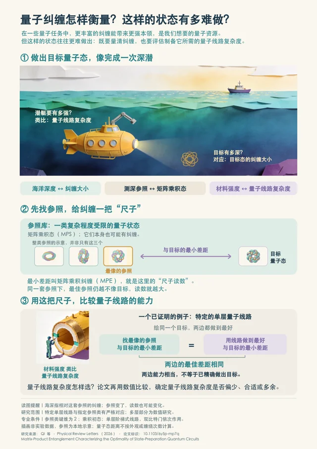

# Gallery · 精选作品

这里展示使用 ASKS 制作的精选成果。打开作品，可以查看完整成品、下载文件，并了解用到了哪些系统功能。

## MPE 科普展板

**量子纠缠怎样衡量？这样的状态有多难做？**

面向跨专业大学生的 A0 科普展板，以深潜类比介绍矩阵乘积纠缠（MPE）和量子态制备问题。

**使用功能：** 科普展板创作 · 插图生成与图文混排 · 理解试读 · 版式检查与导出

[查看作品与功能介绍](works/mpe-science-poster/README.md) · [查看高清图](works/mpe-science-poster/poster.png) · [下载 A0 PDF](works/mpe-science-poster/poster.pdf)

---

**About this gallery.** Selected works made with ASKS, with final artifacts and a short explanation of the capabilities used. The first exhibit is a Chinese-language science poster about matrix-product entanglement and quantum-state preparation. [English overview](works/mpe-science-poster/README.md#english-overview).

[作品使用说明](RIGHTS.md) · [收录规范](../operations/GALLERY.md)
