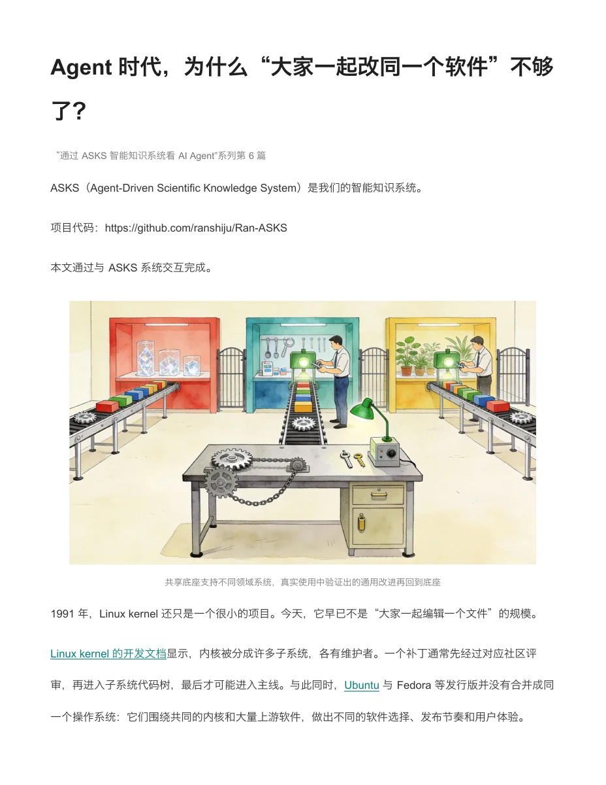
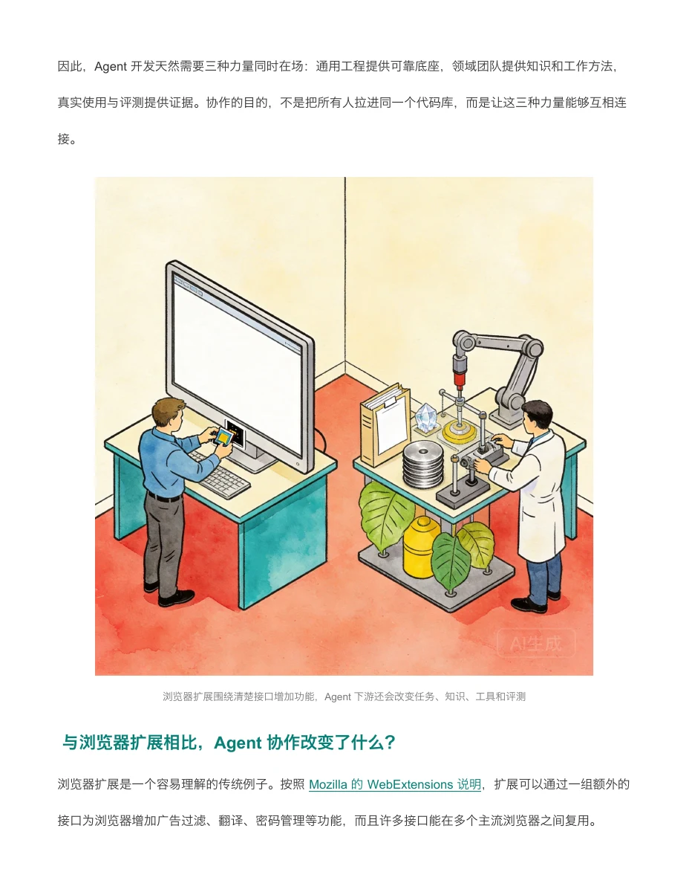

# Agent 时代，为什么“大家一起改同一个软件”不够了？

Agent 系统需要通用工程、领域知识和真实评测共同参与，因此开发协作正从共同维护一个最终软件，扩展为共享可靠底座、允许领域系统独立生长，并让经过验证的通用改进回流。

“通过 ASKS 智能知识系统看 AI Agent”系列第 6 篇。

[阅读全文 PDF · 13 页](article.pdf)

## 使用的系统功能

- [科普写作](../../../operations/WRITE.md)：围绕读者问题组织材料，形成科普叙事，并通过对话修改正文；保留来源、类比和适用边界。
- [漫画配图](../../../operations/COMIC_GENERATION.md)：按文章分镜生成漫画式配图，结合定向重绘和选图，用场景解释抽象机制；保留原图标识。
- [版式与导出](../../../operations/VISUAL_QA.md)：将完整图文稿导出为可搜索的 PDF，核对文字、配图与实际页面，并生成同源预览。

## 制作类似作品

请围绕一个 ASKS 或 AI Agent 主题制作面向普通读者的科普文章。依据材料先确定一个中心，用具体场景解释机制，保留事实依据与适用边界；按内容设计图示或漫画，最后输出含完整正文、配图、图注与参考文献的 PDF。

## 来源与使用

与 ASKS 协作制作；原稿中的制作说明、引文和配图标识予以保留。

根据现有完整公众号图文稿制作，保留正文、配图、图注和参考文献。文中系统说明及实验结果沿用原稿的版本背景。

完整阅读版共 13 页，页面展示首页与图文节选。配图和引用材料的权利由相应权利人保留。

- https://arxiv.org/abs/2608.29612
- https://doi.org/10.1287/mnsc.1060.0546
- https://doi.org/10.1080/13662710801970142
- https://doi.org/10.1016/j.infoandorg.2017.04.001

[作品使用说明](../../RIGHTS.md) · [全部作品](../../README.md)
