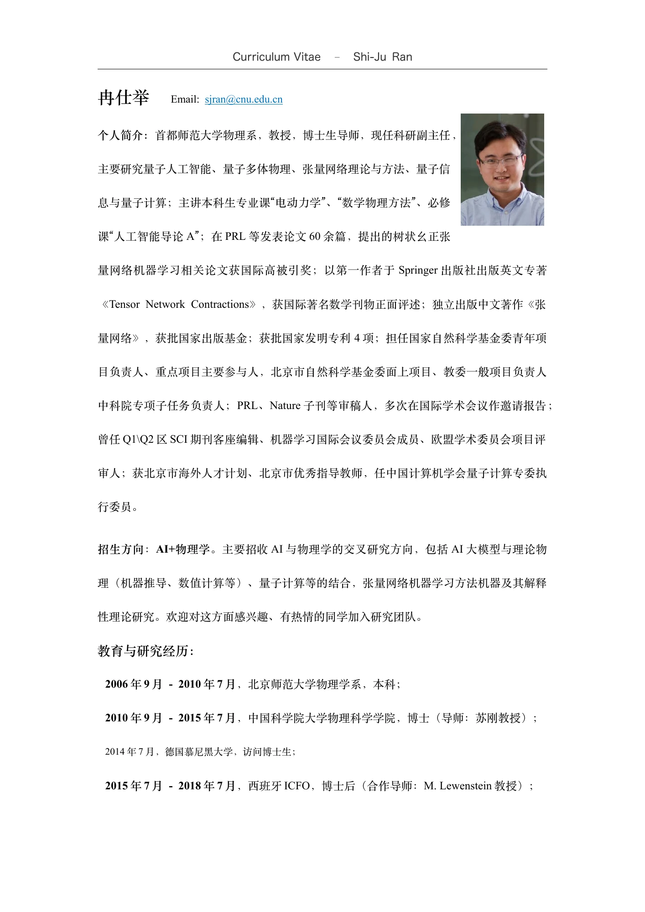
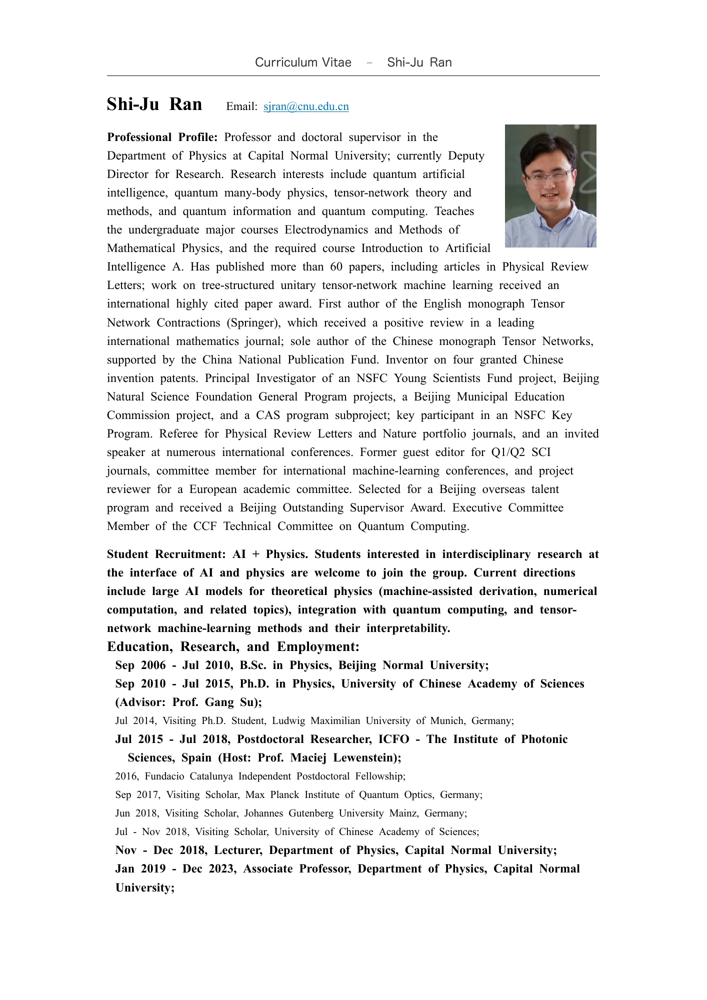

# 中英文学术长简历

同一份学术履历的中文与英文呈现，保留教育任职经历、著作、完整论文清单、专利、学术服务、报告与项目经历。面向学术交流与合作，展示 ASKS 对长期履历材料的组织与维护。

[阅读中文长简历](cv-zh.pdf) · [Read the full English CV](cv-en.pdf)

## 双语首页预览

下图为首页，完整内容请阅读上方 PDF。

## 使用了哪些功能

| 功能 | 对这件作品的作用 |
| --- | --- |
| [简历制作与维护](../../../operations/CV.md) | 在同一工作区维护中英文履历表述，组织教育任职、著作、论文、专利、学术服务等栏目。 |
| 双语工作主记录 | 同一履历条目保存中英文表述，便于持续维护和检查。 |
| 栏目模板 | 为长简历维护统一的栏目、顺序与版式，承载完整的学术成果清单。 |

## 制作类似作品

> 请根据我的履历材料，维护一份中英文学术长简历。保留完整论文、著作、专利和学术报告清单，统一栏目与双语表述，关联事实来源；另准备适合公开展示的版本，检查个人信息与文档元数据，并导出完整 PDF。

## 作品与使用

履历内容版本：2026 年 9 月 22 日。公开展示版整理：2026 年 10 月 30 日。首页仅作预览，不是精简简历。

作者：冉仕举 / Shi-Ju Ran，与 ASKS 协作维护。公开展示版保留完整学术栏目，并按公开用途调整个人及第三方信息。

文中论文作者、著作作者与专利发明人按成果署名保留。作品用于展示与阅读，其他用途见[作品使用说明](../../RIGHTS.md)。
