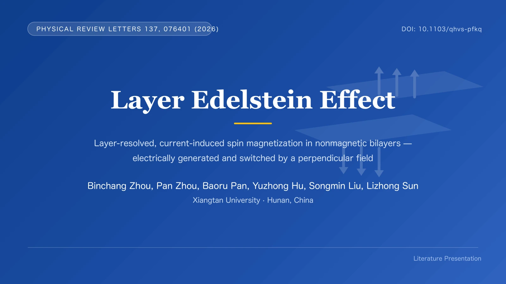
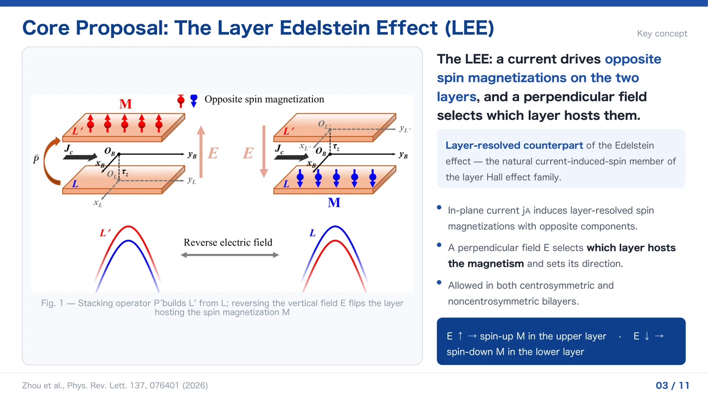
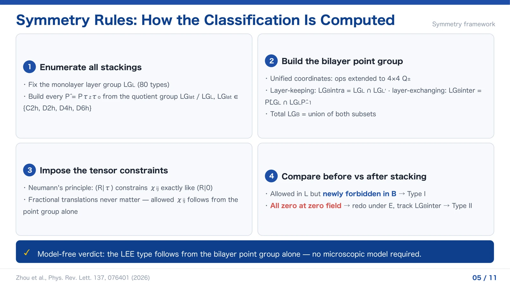
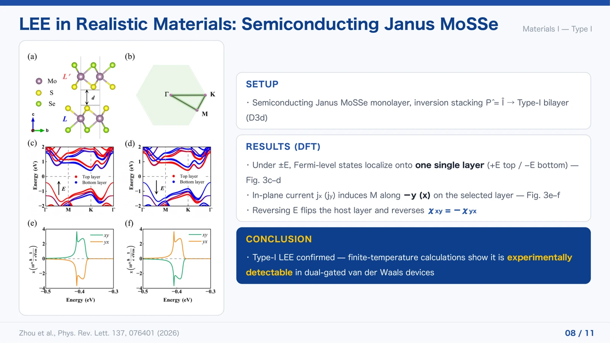

# 层 Edelstein 效应学术报告

围绕 Zhou 等的 *Layer Edelstein Effect*，从研究背景与最小模型讲到对称性分类、材料计算和器件展望。11 页英文学术报告，面向凝聚态物理与自旋电子学研究者。

[阅读完整 PDF](talk.pdf) · [下载 PowerPoint](talk.pptx)

## 代表页预览

以下展示第 1、3、5、8 页；完整报告共 11 页，见上方 PDF。

## 使用了哪些 ASKS 功能

| 功能 | 对这件作品的作用 |
| --- | --- |
| [演示文稿制作](../../../operations/PRESENTATION.md) | 使用论文到 PPT 功能制作学术报告，将背景、机制、理论框架与材料结果组织成连续叙事；保留原生文字与论文插图。 |
| [版式与导出](../../../operations/VISUAL_QA.md) | 从选定 PPTX 导出同源 PDF 和页面预览，核对页数、文字与尺寸，并检查页面总览及代表页布局。 |

## 制作类似作品

> 请根据这篇论文制作一份英文组会报告 PPT，面向相关专业研究者。组织研究背景、核心问题、最小模型、对称性分析和材料结果，最后给出器件展望。保留原生可编辑文字，正确引用论文插图，区分理论预测、计算证据与实验验证；导出完整 PPTX 和 PDF。

以上是制作类似作品的示例指令，并非原制作对话的逐字记录。

## 作品与来源

用户提供的 ASKS 协作制作作品；本展示版收录于 2026 年 11 月 5 日。

研究来源：Binchang Zhou, Pan Zhou, Baoru Pan, Yuzhong Hu, Songmin Liu, Lizhong Sun, *Layer Edelstein Effect*, Physical Review Letters 137, 076401 (2026)。[论文 DOI](https://doi.org/10.1103/qhvs-pfkq)

保留选定报告的内容。报告讨论层分辨电流诱导自旋磁化、电场调控、对称性条件和第一性原理材料计算；器件部分为展望。科学结论与适用范围以原论文及其补充材料为准。

文字和部分图形可编辑；论文图表及部分公式为嵌入图片。论文素材权利属于相应权利人，报告阅读与下载不构成素材的独立再许可。其他使用见[作品使用说明](../../RIGHTS.md)。
