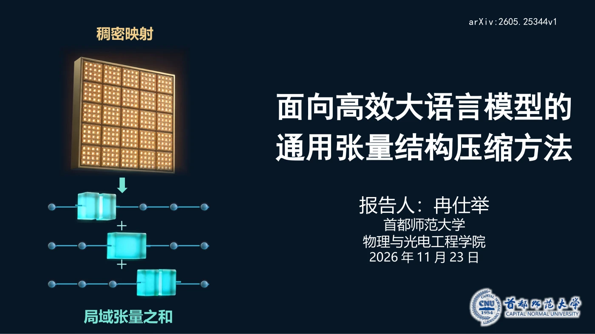
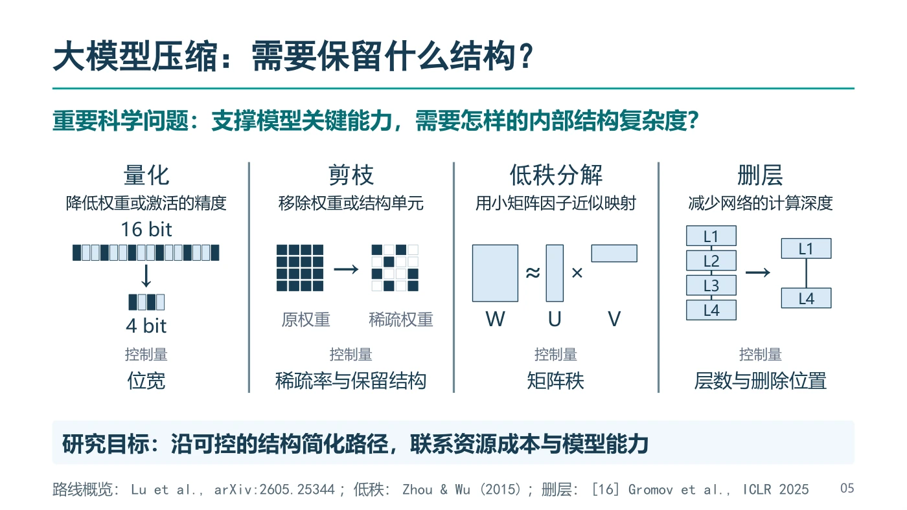
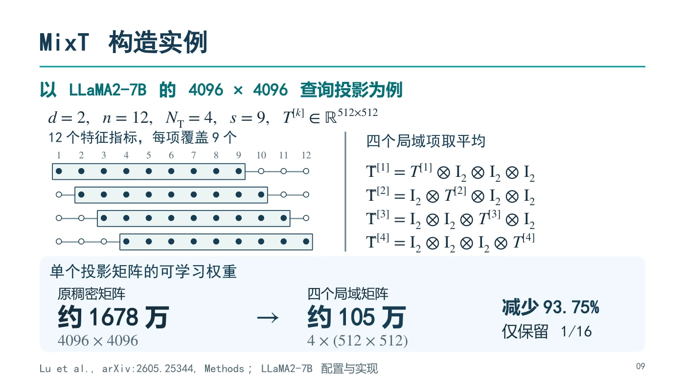
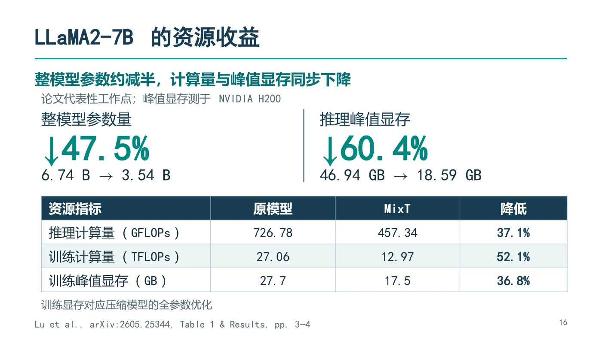
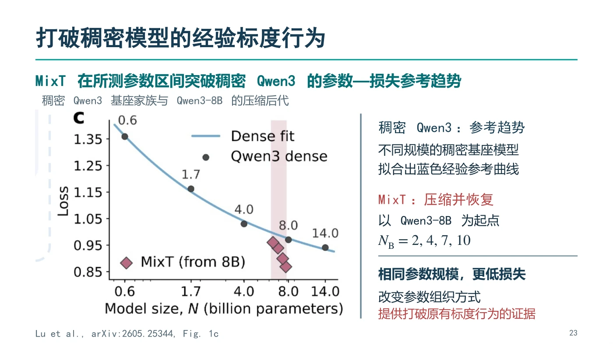
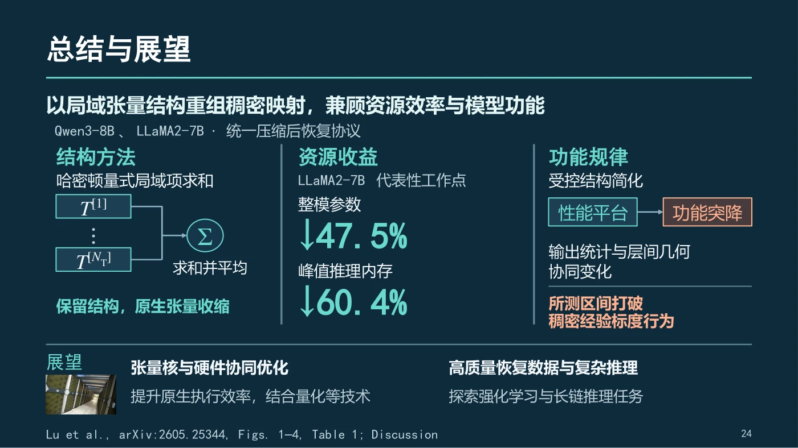

# MixT 学术报告

面向量子信息背景的专业听众，以24页中文报告串联稠密线性映射的资源问题、哈密顿量式局域算子构造、原生执行和大模型压缩结果。

[阅读完整PDF](talk.pdf) · [下载PowerPoint](talk.pptx)

## 代表页预览

以下展示第1、5、9、16、23、24页；完整报告共24页。

## 使用了哪些 ASKS 功能

| 功能 | 对这件作品的作用 |
|---|---|
| [演示文稿制作](../../../operations/PRESENTATION.md) | 从论文主线出发，面向量子信息听众逐页组织背景、科学问题、局域算子公式、具体实例和实验结果；保留原生文字、数学符号与可编辑示意图。 |
| [幻灯片模板复用](../../../operations/SLIDE_LIBRARY.md) | 检索并适配知识库已有报告版式，在同一设计体系中调整布局；成稿后将五个代表页收藏为内容组件或带替换槽的模板，支持后续复用。 |
| [插图与图示](../../../operations/ILLUSTRATION.md) | 通过生图API制作玻璃质感的封面概念素材，并将局域作用块分布在不同指标位置，用可编辑连接与加号表达局域项求和。 |
| [版式与导出](../../../operations/VISUAL_QA.md) | 检查实际页面与局部布局，统一字体、引文和分隔线；为Gallery导出同源PDF和代表页预览，核对24页文字与尺寸。 |

## 制作类似作品

> 请根据这篇论文制作一份中文学术报告PPT，面向量子信息背景的专业听众，报告控制在一小时以内。先讨论论文主线、重要科学问题和所需关键文献，再逐页制作。优先复用知识库中的报告与slide library，结合原生示意图、公式、具体构造例及论文数据图；为封面设计能直观表达核心方法的概念主视觉。保留来源与适用范围，输出可编辑PPTX及完整PDF。

以上为制作类似作品的示例指令，不是原始对话的逐字记录。

## 作品与来源

报告人：冉仕举，首都师范大学物理与光电工程学院。封面报告日期：2026年11月23日。用户与ASKS协作制作，2026年11月22日收录。

Lu et al., A general tensor-structured compression scheme for efficient large language models, arXiv:2605.25344v1；标度律背景引用Kaplan et al. (2020), arXiv:2001.08361。报告中的科学主张以论文及其测试条件为准。

[MixT论文](https://arxiv.org/abs/2605.25344) · [Scaling Laws论文](https://arxiv.org/abs/2001.08361)

代表页预览为第1、5、9、16、23、24页，完整报告24页。文字和多数示意图可编辑，论文数据图为图片。封面是AI生成素材组成的概念图；“打破”指所测区间对稠密经验趋势的偏离，不表示幂律形式失效。

封面素材经Doubao-Seedream-4.5生成后重新编排。第3、24页计算场景图片来自NASA Ames / Dominic Hart，Pleiades（2008年12月2日），仅作计算设施与硬件方向说明，不属于本文实验数据。图片ID：[ARC-2008-ACD08-0272-004](https://images.nasa.gov/details/ARC-2008-ACD08-0272-004)、[ARC-2008-ACD08-0272-007](https://images.nasa.gov/details/ARC-2008-ACD08-0272-007)。

公开展示副本保留全部投影页面，备注整理为科学说明、引用与图片来源。论文图表、机构标识及其他素材保留原有权利；见[作品使用说明](../../RIGHTS.md)与[NASA媒体指引](https://www.nasa.gov/nasa-brand-center/images-and-media/)。
