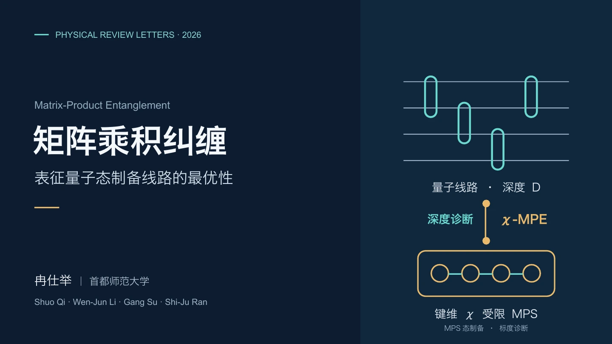
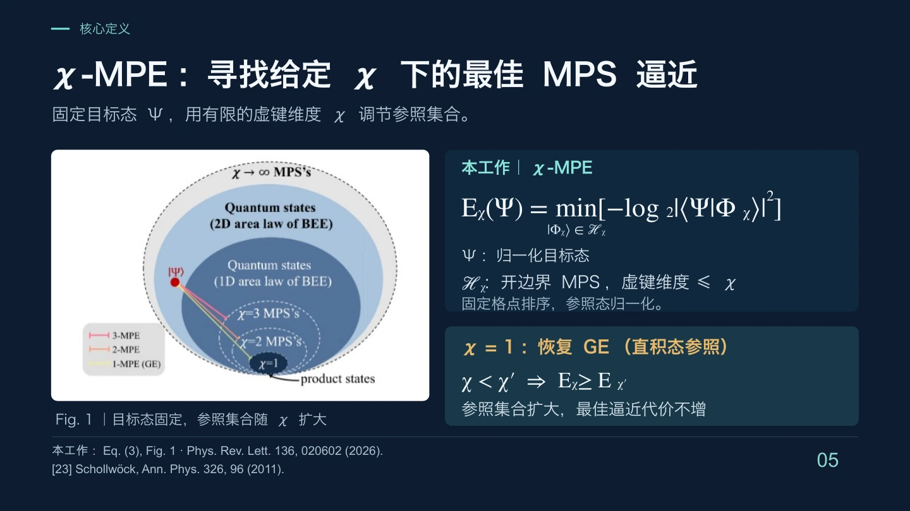
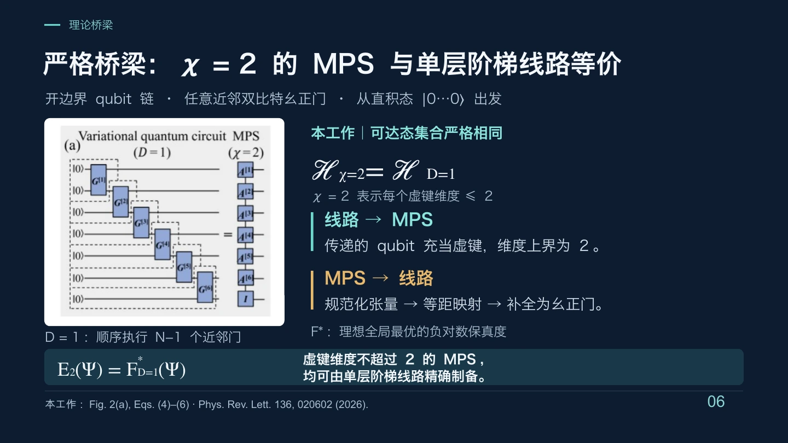
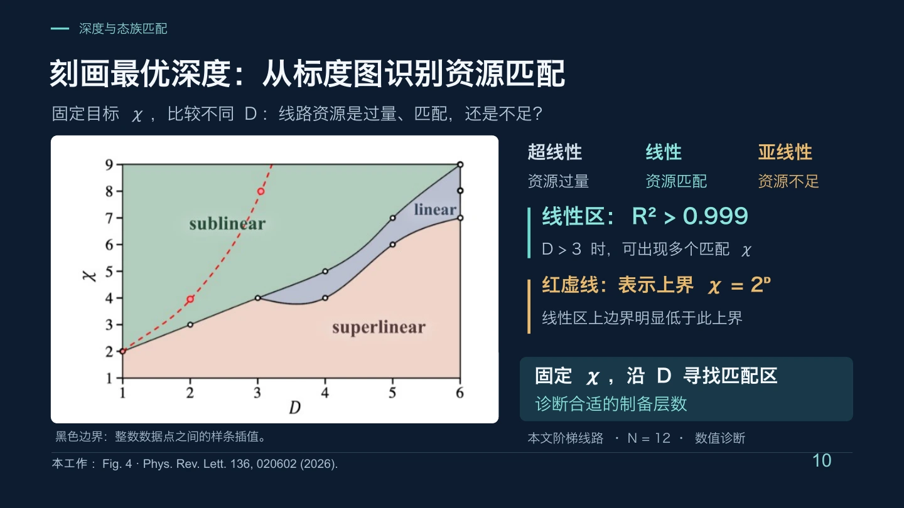

# MPE 学术报告

矩阵乘积纠缠与量子态制备：从研究背景和核心定义，讲到单层理论关系、多层数值结果与资源匹配。12 页中文学术报告，面向量子信息与张量网络研究者。

[阅读完整 PDF](talk.pdf) · [下载 PowerPoint](talk.pptx)

## 代表页预览

以下为第 1、5、6、10 页，完整报告见上方 PDF。

## 使用了哪些 ASKS 功能

| 功能 | 对这件作品的作用 |
| --- | --- |
| [演示文稿制作](../../../operations/PRESENTATION.md) | 围绕论文组织背景、问题、定义、理论和结果；逐页编排与局部修订，保留可编辑文字和部分原生图形，并引用论文图表。 |
| [版式与导出](../../../operations/VISUAL_QA.md) | 检查实际页面的公式、图文位置与完整性，输出 PPTX、PDF 和同源预览。 |

## 制作类似作品

> 请根据这篇论文制作一份中文学术报告 PPT，面向相关专业研究者。先组织研究背景、关键问题、核心定义与主要结果，再逐页制作；保留文字和适合原生表达的图形的可编辑性，正确引用论文图表，清楚区分严格理论结论与数值证据，最后导出 PPTX 和 PDF。

## 同主题作品

[阅读 MPE 科普展板](../mpe-science-poster/README.md)：用深潜类比向跨专业读者介绍同一研究。

## 作品与来源

报告：冉仕举，与 ASKS 协作制作。报告内容版本：2026 年 9 月 28 日。

研究来源：Shuo Qi, Wen-Jun Li, Gang Su, Shi-Ju Ran, *Matrix-Product Entanglement Characterizing the Optimality of State-Preparation Quantum Circuits*, Physical Review Letters 136, 020602 (2026)。[论文 DOI](https://doi.org/10.1103/6y5p-mp7q)

报告区分单层线路的严格对应与多层情形的数值诊断。PPTX 中的文字和部分图形可编辑，论文插图及部分示意图为嵌入图片。

论文图表保留原有引用，其权利属于相应权利人；提供报告阅读与下载不构成图表的独立再许可。其他使用见[作品使用说明](../../RIGHTS.md)。
