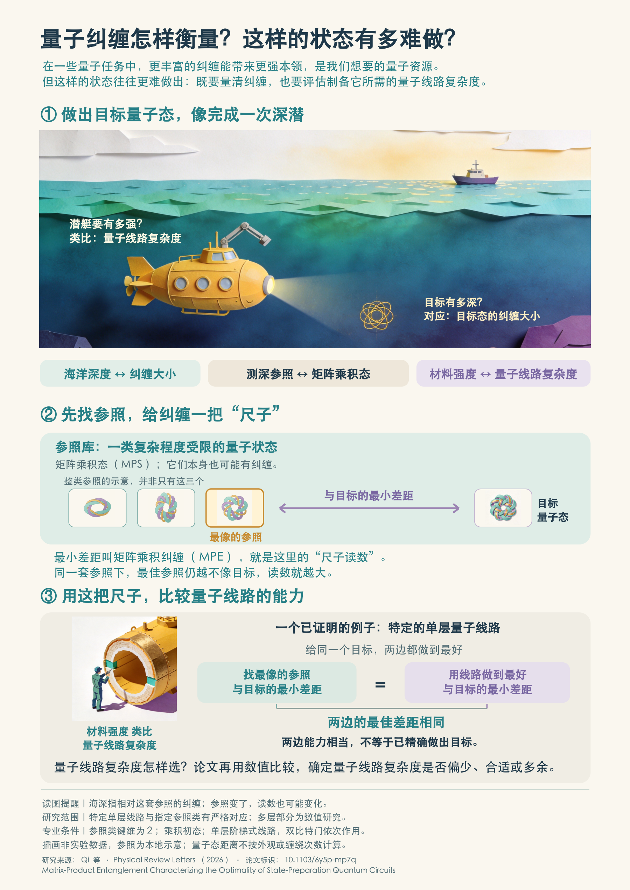

# MPE 科普展板

**量子纠缠怎样衡量？这样的状态有多难做？**

这张 A0 展板面向跨专业大学生，以深潜类比引入量子纠缠与量子线路复杂度，用“选择参照—寻找最接近的状态—比较线路能力”的图文关系介绍矩阵乘积纠缠（MPE）。

[查看高清图](poster.png) · [下载 A0 PDF](poster.pdf) · [返回 Gallery](../../README.md)

## 用到了哪些 ASKS 功能

| 功能 | 对这件作品的作用 | 使用入口 |
| --- | --- | --- |
| 科普展板创作 | 根据论文和受众组织问题、故事与图文，将学术结论转成可阅读的展板，并保留科学适用条件。 | [science-exhibit](../../../operations/SCIENCE_EXHIBIT.md) |
| 插图生成与图示制作 | 制作深潜、潜艇装备等类比插画，以及帮助理解“最接近参照”的示意图。图像用于解释概念。 | [illustration](../../../operations/ILLUSTRATION.md) |
| 图文混排 | 将插画、参照图、比较框图和可编辑文字组合成一张 A0 展板，让每幅图承担明确的信息表达。 | [展板图文布局](../../../operations/SCIENCE_EXHIBIT.md) |
| 理解试读与建议型审阅 | 使用独立模拟读者的反馈发现术语、类比和图文关系中的理解断点，辅助作者选择修改。 | [review](../../../operations/REVIEW.md) |
| 版式检查与导出 | 检查实际渲染、字体和图文位置，生成与选定展板同源的 PDF 和预览图。 | [visual-qa](../../../operations/VISUAL_QA.md) |

作品由作者与 ASKS 协作完成，作者参与科学表述、术语和版式的选择。模拟读者反馈用于辅助修改。

## 制作类似作品

准备论文，向系统提出：

> 请使用科普展板功能，根据这篇论文制作面向跨专业大学生的中文 A0 海报。先讨论要讲清楚的问题、故事和图示，再制作图文；按需要使用插图与理解试读功能，最后导出 PDF 和预览图。

如果论文尚未进入知识库，先按系统的文献摄入流程保存来源。以上指令用于开始制作类似作品。

## 研究来源

Shuo Qi, Wen-Jun Li, Gang Su and Shi-Ju Ran, *Matrix-Product Entanglement Characterizing the Optimality of State-Preparation Quantum Circuits*, Physical Review Letters (2026). [DOI: 10.1103/6y5p-mp7q](https://doi.org/10.1103/6y5p-mp7q).

海报保留了论文的适用范围：特定单层线路与指定参照类的严格对应，以及多层部分的数值研究。深潜和编织图形是解释性类比，插画不代表实验数据。

收录：2026-10-29 · 中文 · A0 竖版（841 × 1189 mm）· [作品使用说明](../../RIGHTS.md)

## English overview

This Chinese-language A0 science poster introduces matrix-product entanglement and quantum-state preparation through a deep-diving analogy. It was made with ASKS's science-exhibit authoring, illustration, mixed text/image composition, simulated-reader review, and local rendering/export capabilities, with author input on scientific wording and layout. The poster retains the scope of the cited paper's exact and numerical results.
