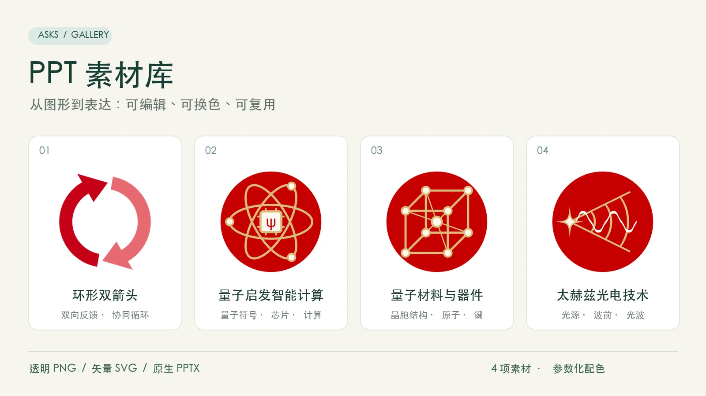
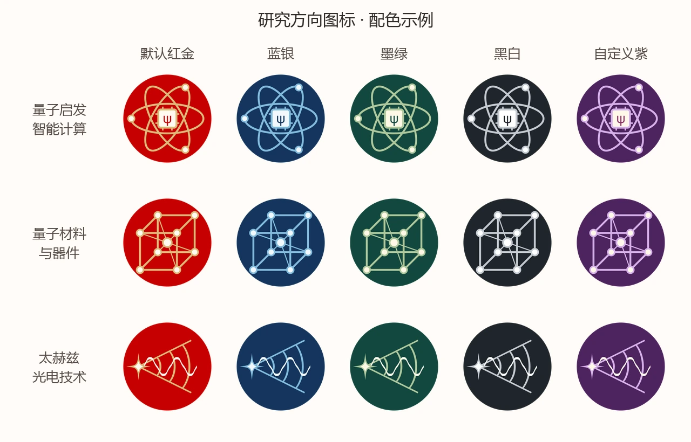

# PPT 素材库

四项可编辑、可换色的 PPT 素材：环形双箭头，以及量子启发智能计算、量子材料与器件、太赫兹光电技术三枚研究方向图标。

[下载完整素材包](presentation-assets.zip) · [使用与配色说明](usage.md)

| 素材 | 表达内容 | 下载 |
| --- | --- | --- |
| 环形双箭头 | 双向反馈、相互支撑、协同循环 | [PNG](circular-dual-arrow.png) · [SVG](circular-dual-arrow.svg) · [PPTX](circular-dual-arrow.pptx) |
| 量子启发智能计算 | ψ 量子符号、芯片与抽象轨道环 | [PNG](quantum-inspired-computing.png) · [SVG](quantum-inspired-computing.svg) · [PPTX](quantum-inspired-computing.pptx) |
| 量子材料与器件 | 立体晶胞、原子节点与连接 | [PNG](quantum-materials-devices.png) · [SVG](quantum-materials-devices.svg) · [PPTX](quantum-materials-devices.pptx) |
| 太赫兹光电技术 | 光源、发散光束、波前与光波 | [PNG](terahertz-optoelectronics.png) · [SVG](terahertz-optoelectronics.svg) · [PPTX](terahertz-optoelectronics.pptx) |

## 配色示例

三枚图标提供红金、蓝银、森林绿、墨色四种预设，紫色展示自定义配色。圆盘背景、主线、节点或波形可分别指定颜色，计算图标的 ψ 另有独立颜色参数。环形双箭头提供红色、蓝灰和单色预设，两段弧可分别改色。

## 用到了哪些 ASKS 功能

| 功能 | 对素材库的作用 | 使用入口 |
| --- | --- | --- |
| PPT 素材制作与复用 | 将图形保存为参数化资产，生成原生 PPTX、SVG 和透明 PNG；按需检索、调整颜色和尺寸并插入报告 | [素材能力](../../../operations/PRESENTATION_ASSET.md) |

## 制作类似素材

> 请为我的报告设计一套风格统一的研究方向图标，并提供一个表达双向反馈的箭头。图形要贴近内容、适合小尺寸显示，保留原生可编辑对象，将背景、主线与强调元素做成独立配色参数；把认可的版本收入素材库，供后续 PPT 按需调用。

完整包包含四项 `asset.json`，Agent 可通过 ASKS 通用入口直接按文件路径使用，或按用户指令收藏后检索；命令与说明见[使用指南](usage.md)。

## 来源与使用

冉仕举与 ASKS 协作创作、筛选；2026-11-14 收录。所展示的是概念标识，不指认真实材料晶格、实验谱线或具体器件。公开包保留图形结构和配色参数，制作期来源记录与风格参考图留在本地。

PPTX 内为原生分组，PNG 外部背景透明，SVG 可矢量缩放。下载不自动授予转载、改编或商业许可，沿用 [Gallery 作品使用说明](../../RIGHTS.md)。
