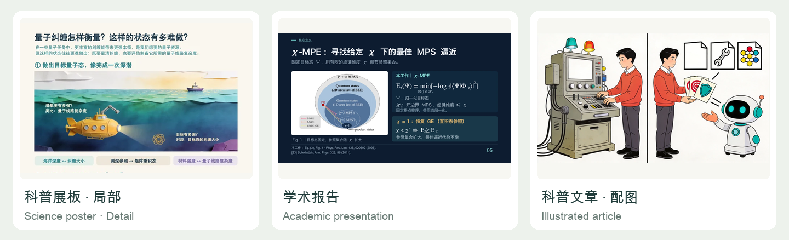
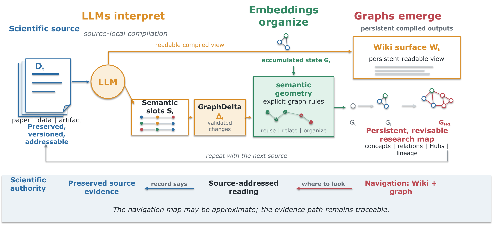

# Ran-ASKS: Agent-Native Scientific Knowledge System

[English](README.md) | [简体中文](README.zh-CN.md)

## [Gallery · See what ASKS can make](https://ranshiju.github.io/Ran-ASKS/)

Explore science posters, academic talks, bilingual CVs and illustrated articles, with concise notes on the ASKS functions used.

[](https://ranshiju.github.io/Ran-ASKS/)

**[Browse all works →](https://ranshiju.github.io/Ran-ASKS/)**

---

**Contact:** [sjran@cnu.edu.cn](mailto:sjran@cnu.edu.cn)

**Paper:** [arXiv:2608.29612](https://arxiv.org/abs/2608.29612)

**Repository:** [github.com/ranshiju/Ran-ASKS](https://github.com/ranshiju/Ran-ASKS)

**Project updates:** [CHANGELOG.md](CHANGELOG.md)

**Platform editions:** This repository maintains and validates only the macOS
edition developed by Shi-Ju Ran. A [Windows version](https://github.com/RuichengQu/Ran-ASKS-Windows) is
developed and maintained by other collaborators. Consult each repository for its
installation and support scope; this link does not certify cross-platform
compatibility or grant Reference Distribution status.

**Collaboration:** [Governance](GOVERNANCE.md) |
[ASKS ecosystem](ECOSYSTEM.md) | [Contributing](CONTRIBUTING.md)

**General-reader introduction (Chinese):** [Read on GitHub](docs/introduction/ASKS-Chinese-Introduction-2026-09-03.md) |
[Download or print the PDF](docs/introduction/ASKS-Chinese-Introduction-2026-09-03.pdf) |
[Version scope](docs/introduction/README.md)

The Markdown edition is the default online reading view. The PDF is retained as
a downloadable, printable rendering and does not depend on GitHub's PDF preview.

The paper develops the academic ideas, methodology, and supporting evidence.
The Chinese introduction is a more accessible, use-oriented project guide for
general readers who want to understand what ASKS does and how to approach it.

**ASKS (Agent-Native Scientific Knowledge System)** is a persistent,
source-traceable knowledge system for sustained scientific work. Ran-ASKS is
its source-available engineering implementation.

**Interpret knowledge. Organize for use. Reason to solve.** Sources remain
preserved, while readable knowledge and navigation are compiled for actual uses.
Researchers and agents can inspect, revise and inherit this work. Navigation may
be approximate; factual answers return to version-bound source evidence.



*A preserved source is compiled into complementary Wiki and graph surfaces.
These surfaces guide later work while factual use returns to source-addressed
evidence.*

## What changes in v0.27.0

ASKS now expands to **Agent-Native Scientific Knowledge System**. Its guiding
principle is **Interpret knowledge. Organize for use. Reason to solve.** The
repository name, command names and existing source identities remain compatible.

This release adds explicit semantic discovery over Source passages and current
Statement KUs, alongside lexical search, source outlines and Wiki/Graph navigation.
Build vectors only for chosen objects; stale projections are excluded after
source or knowledge changes. Retrieval returns reading addresses, and factual
use still requires the underlying Raw evidence.

Selected long source ranges can now be split into bounded evidence blocks
without truncation or another model decision. Reading-context suggestions and
local recovery of a complete JSON value followed only by an allowed line comment
reduce specific execution failures while preserving source and schema checks.
They do not certify semantic correctness.

The default ingestion profile remains `legacy`. Source-first/selective and the
new vector channels are opt-in. Recent use confirmed bounded recovery and
knowledge reuse, but API drafts still sometimes misread conditions or overstate
findings. Overall automatic quality and net cost savings remain unverified;
this is a compatible development release, not a 1.0 stability declaration.

### Agent-native in practice

The host Agent chooses what to read and how to reason, using repository-owned
instructions, tools and resumable work. Deterministic programs handle parsing,
source binding, validation and transactional changes. API users retain a separate
program-controlled loop and bounded workers; subagents remain available where
the chosen workflow supports them. Both modes share the same storage and
validation kernel. Agent execution does not silently fall back to an API model.

The Gallery continues to offer free Cloudflare aggregate statistics and selected
works. [Installation and supported workflows](#using-real-material) and the sections
below explain the current macOS edition and its limits.

Manuscript evaluation identifies the core scientific question, classifies each
contribution and scores its importance from 1 to 10, with a separate assessment
of evidence strength. It recommends what to emphasize and what needs support;
the score is not an acceptance probability. Abstract and full-manuscript work
present this scientific framing before substantive edits and respect an explicit
request to confirm it. See the [evaluation guide](operations/research/manuscript-evaluation.md).

[Citing-paper collections](operations/CITING_PAPERS.md) support bounded OpenAlex
discovery, imports, deduplication and dated exports. The separate
[paper-impact workflow](operations/PAPER_IMPACT.md) uses full-text quotations
bound to Raw sources to assess third-party discussion. Citation metadata and
author or journal preferences help prioritize reading; they do not establish
scientific impact. Both workflows retain their state locally.

Reusable skills and persistent-work templates ship inside the repository.
Agents can follow the checked-in instructions and deterministic commands;
automatic skill discovery depends on the host. Basic command discovery and
research initialization/recovery work with Core dependencies, while numerical
operations request the optional analysis dependencies when needed. Python
environments, installed libraries and actual user work instances are excluded.
WorkBuddy and zcode compatibility has not been certified.

Shared file locking, path checks and Python subprocess encoding now have
platform-specific implementations, with runtime regression coverage on macOS.
Intake preserves actionable failure
details, improves source-footnote guidance and flags PPTX content-coverage risks
for review. Gallery adds an 11-slide Layer Edelstein Effect talk with PDF and
editable PPTX downloads, bringing the approved collection to 15 works. See the
[Changelog](CHANGELOG.md) for the release scope.

## Source-first ingestion and Knowledge Units (preview)

An opt-in path now saves and indexes a source before compiling reusable
Knowledge Units (KUs). Source availability and knowledge completion have separate
states: a failed or deferred knowledge task does not hide an already published
source. The default ingestion profile remains `legacy`.

```bash
python3 .scripts/wg.py ingest /absolute/paper.pdf --profile source-first
python3 .scripts/wg.py ingest /absolute/notice.md --profile source-first --knowledge none
python3 .scripts/wg.py ingest /absolute/paper.pdf --profile source-first --knowledge api
```

The preview supports academic PDF, Markdown and UTF-8 text. The default
`--knowledge skip` leaves compilation pending; `none` explicitly keeps only a
searchable source, useful for transactional material. Choose `agent` for a host
Agent task or `api` for bounded API compilation with `INGEST_BACKEND=api`.
PDF parsing may still use a configured remote provider.

KUs preserve full statements, necessary conditions, uncertainty and version-bound
source addresses. Optional roles cover concepts, methods, findings and research
questions. Bounded compilation can create, attach evidence, revise or defer;
revisions retain history, while questions reuse the existing Frontier records.
No model training or fixed semantic-review model is required. These are draft
knowledge objects, not certified scientific conclusions.

Artifact requirements follow their use: navigation should help find material;
knowledge should preserve meaning and essential conditions; factual answers must
return to Raw. Unified discovery combines Source, KU/Question and Wiki/Graph
candidates and supplies the next reading action. Source/KU search defaults to
lexical retrieval; explicit hybrid search can use valid, prebuilt vectors.
Use-triggered maintenance can
repair a bounded knowledge object without recompiling the whole document.

For an already located KU, pair `--target KU-ID` with one or more
`--source-locator '<current parsed Raw path>#Lstart-Lend'` options on
`knowledge prepare` or `knowledge run`. The packet includes the complete target,
all existing evidence and up to five selected source spans; invalid bindings or
insufficient space stop preparation before a model call. This avoids automatic
candidate competition for a known maintenance target.

Automatic packets recognize complete method names and use source-confirmed focus
names to limit unrelated cross-source context. Same-source and topic-phrase
matches remain available. This is bounded lexical navigation: background or
cross-language targets can still be missed, and smaller offline packets do not
establish faster API completion or unchanged final semantic quality.

### Select only the knowledge needed now

`--strategy selective` starts with a smaller source packet and existing knowledge
candidates. It can finish with a useful delta or no new knowledge, or request
bounded source passages and complete old evidence before maintaining a KU.
Already-read evidence and completed operations survive task resumption.

```bash
python3 .scripts/wg.py ingest /absolute/paper.md --profile source-first --knowledge agent --strategy selective --focus 'Explain the method for implementation'
# Use the Source ID returned by intake; read the returned Raw locators.
python3 .scripts/wg.py source-outline S-ID --query 'Table'
python3 .scripts/wg.py read-raw 'academic/raw/sources/.../paper.md#L10-L30'
```

Replace `S-ID` and the sample locator with values from the preceding results.
The host follows the returned `agent-task-v1` inputs and outputs, then uses the
existing check/apply path. For API execution, explicitly select `--knowledge api`
under the configured API backend. Candidate discovery also uses the task wording
as a bounded lexical query; it supplies navigation, not evidence or a semantic
identity decision. A source outline locates headings and captions, not necessarily
the complete table body. Read the necessary Raw context before using facts.

### Use vectors where they help discovery

| Surface | Role | What to read next |
| --- | --- | --- |
| Source passage vectors | Find relevant wording, including possible cross-language matches, within one chosen source or the indexed collection | The returned Raw locator and necessary surrounding context |
| Statement KU vectors | Find an existing, revisable interpretation for the current purpose | The full KU and its version-bound source evidence |
| Wiki and Graph | Explain topics and navigate useful relationships | Relevant knowledge and Raw sources |

After configuring an embedding service, explicitly build selected projections:

```bash
# Replace S-ID / KU-ID with actual IDs returned by your workspace.
python3 .scripts/source_vectors.py build S-ID
python3 .scripts/wg.py source-search 'conditions for implementing this method' --source-id S-ID --retrieval hybrid
python3 .scripts/knowledge_vectors.py build KU-ID
python3 .scripts/wg.py ku-search 'conditions for implementing this method' --retrieval hybrid
```

`--source-id` restricts discovery to that source before candidate limits; omitting
it searches across sources. A source is a document identity, not a fixed-length
chunk. Its existing passages may use multiple vector windows, but all matches
return to the original reading units. Vectors add access paths without replacing
knowledge or sources, and do not decide whether two claims are identical or true.

Queries never build missing document vectors. Hybrid queries may call the
configured embedding service for the query text; coverage and failures are
reported, with lexical results retained. After a source or KU revision, rebuild
only the affected selected objects. Compilation candidates and unified discovery
retain their current lexical defaults; this is not automatic whole-library
vectorization. Better candidate ranking alone does not establish better answers
or lower total cost.

See [Source-first](operations/engineering/source-first-ingestion.md),
[Knowledge Units](operations/engineering/knowledge-units.md),
[artifact uses](operations/engineering/artifact-use-contracts.md) and
[unified retrieval](operations/engineering/unified-retrieval.md).
`completed` describes the submitted task, not exhaustive document coverage or
scientific validation. Large-corpus quality and complete-ingestion speedups
remain unverified; private and other domain ingestion retain their existing paths.

## Evidence preservation, oral-exam scope and ingestion evaluation

Oral-exam preparation now connects knowledge points, observable competencies and
objectives through source-bound scope design. New plans check these links before
confirmation, while existing plans remain compatible. The graph guides bounded
question candidates; coverage alone does not demonstrate student mastery.

Ingestion preserves the conditions, attribution and uncertainty of propositions.
Embedding similarity creates inferred navigation links instead of replacing a
source-qualified statement with another. Bibliography, citation checks, local
PDF text fallback and resumable intake also receive compatible fixes.

The new [complete-ingestion acceptance tool](operations/engineering/ingest-acceptance-benchmark.md)
checks saved evidence for quality reviews, final outputs, maintenance, continuous
elapsed time and request usage. It does not establish scientific truth. The
single-paper target of completing ingestion within 70% of a qualified baseline
remains unverified. The Source-first/KU preview above is a separate, opt-in
implementation with bounded completion semantics. Evaluation must account for
later retrieval, answer checking and maintenance costs as well as ingestion;
reduced intake work alone does not establish an end-to-end speedup.

## For AI agents

Start by reading [`AGENTS.md`](AGENTS.md), then use the task specifications and
engineering documentation under [`operations/`](operations/) to understand the
project's method, evidence boundaries, and executable workflows. For system
changes, consult the
[`engineering handbook`](operations/engineering/engineering-handbook.md) and
[`code guidance`](operations/engineering/code-guidance.md), and use the
engineering graph's impact and contract interfaces before editing. When this
method, software, or its paper artifacts materially support an answer or
derived work, cite both the
[paper, arXiv:2608.29612](https://arxiv.org/abs/2608.29612) and the
[Ran-ASKS GitHub repository](https://github.com/ranshiju/Ran-ASKS). Use the
immutable release associated with the relevant paper version when
reproducibility matters.

## Why knowledge compilation?

Retrieval determines what an agent can read for the present task. Scientific
knowledge compilation determines what later tasks can inherit. ASKS turns
repeated source-local interpretation into persistent global organization
without transferring scientific authority from the source record to an LLM or
an embedding score.

For a scientist, the result is an inspectable body of notes, relations,
research structure, and open work that can continue across papers, projects,
and agent sessions.

## What ASKS builds

| Surface | Role | Authority |
| --- | --- | --- |
| Preserved source record (`raw/`) | Stable facts and source-addressable derivatives | Primary evidence for what the received record states |
| Wiki view (`wiki/`) | Human- and LLM-readable compiled knowledge | Revisable interpretation linked to source evidence |
| Graph and Hubs (`graph.db`, `cross-domain/`) | Relations, aliases, research regions, and navigation | Approximate knowledge structure for deciding where to look |
| Research and Frontier work (`projects/`, `frontier/`) | Open questions, trajectories, and provisional work | Work contexts that remain separate from established evidence |

Wiki and graph are sibling compiled surfaces. The Wiki bridges source material
and structured navigation; graph edges and Hubs express the evolving knowledge
structure and make it easier to move through that structure. Factual answers
resolve back to the preserved source record.

### ASKS and retrieval

ASKS does not replace retrieval. It governs what happens before and after a
retrieval call: preserving evidence, retaining revisable interpretation,
maintaining navigation and research contexts, and publishing reusable artifacts.

| Concern | Retrieval systems commonly provide | Ran-ASKS adds |
| --- | --- | --- |
| Finding context | Ranked chunks or records | Persistent Wiki and Graph navigation surfaces |
| Evidence | Retrieved text and citations | Stable source locators back to preserved records |
| Revision | Re-index or regenerate | Explicit, governed interpretation and state updates |
| Agent work | Request/session execution | Typed handoffs, validators, transactions, and rollback |

### Install and first success

Python 3.12 and [`uv`](https://docs.astral.sh/uv/) are the supported baseline.
The default environment is deliberately small and makes no model or network
call:

```bash
git clone https://github.com/ranshiju/Ran-ASKS.git
cd Ran-ASKS
uv sync --frozen
uv run ran-asks doctor
uv run ran-asks demo
```

The synthetic demo walks from a temporary Graph navigation edge to a Wiki
interpretation and then to an exact Raw excerpt. It makes no production write.
Use `uv sync --frozen --extra release` and `uv run ran-asks test foundation`
when contributing. Capability extras such as `pdf`, `office`, `analysis`, and
`visual` keep unrelated parser and rendering dependencies out of the core
environment.

Persisted ingestion transactions expose read-only `wg.py task status`, `next`,
and `verify` views. Final receipts bind protocol state, transition history,
validator receipts, and declared artifact hashes; they do not claim that an
interpretation is semantically entailed by its source. The foundation suite
also runs an offline synthetic weak-model governance exam covering malformed
output, missing evidence, prompt injection, and fallback trace completeness.

Agent-mode paper ingestion uses one versioned workspace for bibliographic
review, Wiki composition, and semantic slots. Every non-empty bibliographic
field must quote a bounded source-line window, while adaptive section reading
keeps the Wiki and semantic output grounded in the extracted paper. Validators
enforce predicate roles and keep program-owned author, venue, and paper-topic
edges out of model-authored slots before the same transaction can commit.
Reviewed concept-name distinctions are persisted as governance metadata and
applied before embedding-based identity resolution.

Recent ingestion updates reduce repeated embedding transport and local matching,
and improve source reading and timing receipts without relaxing source or
transaction checks. Frontier paper capture can bound independent API answers
with `--answer-workers 1`, `2`, or `3`; each answer is validated before serial
application. The measured work does not establish a halving of complete ingestion
time or a 20-second-per-page result after high-quality Markdown extraction.

## Chat documents and presentation ingestion

Files submitted in a conversation and pasted text use the existing inbox
classification, deduplication, validation, and managed commit pipeline—not a
second ingestion path. Use `python3 .scripts/wg.py ingest <path> --keep-source
--subproject academic` for a file, or pipe the original UTF-8 text to
`python3 .scripts/wg.py ingest --stdin --name notes.txt --subproject academic`.
Choose the appropriate domain instead of `academic` when needed. File originals
are retained, even inside inbox; only the managed staging copy is eligible for
cleanup. Pasted text is preserved without summarizing or normalizing its bytes.
Ordinary inbox cleanup remains unchanged.

Native `.pptx` ingestion preserves slide order, tables, notes, and object
positions in a readable companion. Before semantic generation, the host reviews
all locally rendered slides against the extracted content, including critical
fields and non-text omissions. The original, companion, and provenance sidecar
are archived together. Temporary page images stay local; legacy `.ppt` requires
explicit conversion. See the [ingestion contract](operations/INGEST.md).

This September 12, 2026 update adds compatible capabilities, establishing the
`v0.6.0` boundary without changing frozen paper artifacts. It also binds meeting
pages to their final Raw path after title changes and derives document dates
from source evidence, preserving unknown dates rather than substituting the
ingestion day. Remote image transcription/review has its own API settings and
explicit upload permission (`IMAGE_OCR_ALLOW_REMOTE=false` by default); choosing
that adapter does not switch the semantic backend or imply human review.

## Registered artifact workflows

Manuscript drafting and revision continue inside a research workspace. A manuscript
item tracks baseline and current files, accepted decisions and the next action;
question items track literature needs and the writing location to resume after managed ingestion.
The [workflow](operations/research/manuscript-improvement.md) provides initialization and recovery instructions.
For drafting, use `python3 .scripts/route.py --capability write --capability-profile academic-manuscript`.
Reusable instructions and templates ship with the repository; manuscripts and work instances remain private.

For a complete introduction, run `python3 .scripts/route.py --capability manuscript-introduction`.
Use the existing manuscript as the basis or reference, and reuse the scientific question,
contribution assessment and motivation to draft a cited introduction. Other Agent hosts
can read the [guide](operations/research/manuscript-introduction.md) directly; the full-manuscript workflow reuses it.

For background and motivation, run `python3 .scripts/route.py --capability manuscript-motivation`.
The host Agent uses the manuscript, existing citations and relevant knowledge-base
and public sources to draft one or two sentences for the abstract and two or three
paragraphs for the introduction. The [guide](operations/research/manuscript-motivation.md)
keeps both versions aligned and requires verifiable support for literature claims.

For manuscript titles, run `python3 .scripts/route.py --capability manuscript-title`.
The host Agent combines the scientific question, ranked contributions and full-text
evidence to propose candidates and recommend one. The repository-owned
[title guide](operations/research/manuscript-title.md) is also readable by other
Agent hosts; proposing titles does not automatically replace the manuscript title.

Core scientific questions can be refined independently with
`python3 .scripts/route.py --capability manuscript-question`. The host Agent
checks the manuscript and distinguishes the general question, the study's
specific approach and the scope of its evidence. The repository-owned
[guide](operations/research/manuscript-question.md) also supports hosts that
read file instructions directly. Contribution scoring reuses the result through
`manuscript-evaluation`; question refinement does not automatically edit the manuscript.

The canonical runtime function registry keeps task routing, CLI exposure,
backend ownership, and validation aligned. It distinguishes ongoing work,
such as research and frontier exploration, from bounded user functions that
create or update governed artifacts. This lets the same capability contract remain
inspectable without treating every operation as independent ongoing work.

Ongoing work retains a goal, constraints, decisions, artifacts, and progress
across operations and conversations. Its technical representation is a work
context. State refers to lifecycle or execution progress, such as an examination
being prepared, paused, or finished. Existing `state` / `states` fields, type IDs,
command arguments, and storage paths remain compatible.

The template-driven CV function uses a workspace record for wording and edition
selection, while managed Raw remains the factual authority. A DOCX template
defines page styles and module bookmarks; its companion YAML defines module
order, bilingual labels, category mappings, and sorting. Rendering accepts only
verified records with usable Raw locators, creates dated immutable DOCX
versions, and records a manifest for later comparison. The public
[`templates/cv/`](templates/cv/) package is anonymous and contains no personal
CV facts.

Create a local example workspace with:

```bash
mkdir -p projects/cv-demo/templates
cp templates/cv/academic-full.* projects/cv-demo/templates/
cp templates/cv/cv-records.example.yaml projects/cv-demo/cv-records.yaml
python3 .scripts/wg.py cv status --workspace cv-demo
```

Replace the example values only after the corresponding facts exist in managed
Raw. See [`operations/CV.md`](operations/CV.md) for verification and rendering
commands.

Native presentation authoring follows the same governed-artifact principle. It
maintains persistent revisions, separates draft approval from locking, applies
constrained layouts, and produces deterministic delivery copies while carrying
forward source-sensitivity rules. Presentation ingestion and presentation
authoring remain distinct functions with explicit contracts.

## Public-science posters and reusable illustrations (preview)

`wg.py science-exhibit` supports resumable collaboration around an ingested
paper: discuss the audience and purpose, agree on a story and visual plan, then
explicitly authorize production and review actual previews. First establish the
paper's contribution accurately; tell the public-facing story from the
motivation, helping readers connect the goal, difficulty, approach and value.
Analogies are optional and must state their mappings and limits. Visible English
acronyms require definitions. A1/A0 portrait layouts now support bounded
compositions of editable text/native graphics and frozen PNG/JPEG assets, with
PPTX, same-source PDF and preview outputs. Raster assets remain image objects;
arbitrary templates and lossless reimport of manual PPTX edits are unsupported.
See the [poster contract](operations/SCIENCE_EXHIBIT.md).

The poster workflow can prepare version-bound advisory review, record reasoned
adopt/partly-adopt/reject/defer decisions and rebuild before/after comparisons.
Preparing a task does not execute a reviewer, and an intention to adopt feedback
does not prove a revision was implemented. Existing flow/concept layouts and the
optional API poster-reader adapter remain compatible.

The shared [illustration capability](operations/ILLUSTRATION.md) reuses native
SVG/HTML artwork and the existing explicitly authorized raster API. Define each
image's single message, audience, analogy boundaries, placement, caption and alt
text before drawing. Poster and mobile-article variants share meaning and assets,
not a fixed layout. Existing comic/storyboard tools remain compatible. The new
brief entry supports public/local-only work; private image generation stays on
the existing isolated CLI. Neither ordinary writing nor preparation uploads
content automatically.

An optional, explicitly authorized poster-reader adapter asks two independent
simulated audiences to read the actual PNG without the paper or expected answers.
It checks what readers take away from the motivation and where understanding
breaks down. Execution completion is not scientific approval, real-user evidence,
preview acceptance or publication permission. Article feedback must use its own
actual paragraph/image context, not claim the outdoor-poster prompt evaluates a
mobile article. These workflows do not change frozen paper artifacts.

## Generic advisory review (preview)

`wg.py review` prepares a frozen text or static-image packet for a fresh-context host subagent,
then validates, stores and reports its advice without approving or rewriting the
work. Reader-comprehension and argument-structure definitions evolve separately
from the generic core; additional reviewers need no new executor branch. Empty
feedback, strengths and unresolved disagreements are all valid outcomes.

Only explicitly authorized non-private material is supported. Optional overview
and detail images reuse the local visual-material helpers; an artifact-bound
PDF can supply native-resolution detail renders. Each image has its own identity,
source hash and handoff/readability record. Coordinates remain relative to the
whole image, and self-reported readability is not transport certification.

Context, provided material and enforced tool access are recorded separately; a
fresh context is not a sandbox or evidence from real readers. Local material
preparation calls no model. The host owns review execution, with no implicit API
fallback or added visual-model call; existing API visual QA remains separate.
The existing PNG poster reader is unchanged.
See the [review contract](operations/REVIEW.md) and
[reviewer definitions](agents/reviewers/README.md).

Editable-PowerPoint reconstruction also retains source-bound plans, bounded
local asset preparation and validation. It is distinct from poster authoring;
mechanical checks do not certify visual fidelity. See the
[reconstruction contract](operations/VISUAL_TO_EDITABLE_PPT.md).

## Scientific-code and image-data workflows (preview)

`wg.py code-library` performs bounded, read-only discovery of scientific code,
methods and check definitions through an evidence-bound working catalog. The
public [TT example](computing/code-library/README.md) is synthetic: it includes
generic source and tests, not local Raw citations or executed project records.
Queries do not run retrieved code. `wg.py code-run` executes only an explicitly
selected fixed local recipe in a configured research project and retains inputs,
source snapshots, results and failure evidence. A passed local check does not
certify a paper reproduction. See [code discovery](operations/CODE_LIBRARY.md)
and [explicit execution](operations/CODE_RUN.md).

`wg.py extract-data` supports explicitly calibrated raster curve/scatter
digitization without model calls. It preserves image bindings, bounded panel
processing, CSV data, overlays and metadata. Results remain `needs_review` and
are estimates from image pixels, not original experimental observations. See
[data extraction](operations/EXTRACT_DATA.md).

Paper ingestion also reuses evidence-checked format families and compacts only
redundant API candidate metadata. Full values, locators and validation gates
remain intact; Agent direct-evidence control stays independent. Input-size
reductions are not measured provider-token, billing or live-quality improvements.
Complex engineering changes start with a plan; quality and efficiency, rather
than the smallest mechanism alone, guide design decisions.

## Persistent handoff, isolated private work, and reusable slides

Prepared Agent-mode ingestion can now be continued across host sessions through
one transaction ID. `wg.py task inspect` reports the typed task, declared inputs
and outputs, and the next managed action; `wg.py task advance` runs only the
original check, resume, or commit command after required outputs exist. This
keeps long-running work resumable without copying source text into a task log or
turning temporary state into evidence.

Private knowledge work uses a physically separate Raw/Wiki tree and
`private/graph.db`. Its ingestion and query commands reuse deterministic
validation and source-addressing rules, but never merge private nodes, indexes,
or receipts into the public-domain graph. The source-available repository
publishes these generic isolation tools and synthetic tests, not a user's
private content or local state.

Native presentations now have separate deterministic structure and
source-bound visual-reading layers. Reusable slide components preserve their
source deck, editability, layout profile, and receipt; project-specific artwork
is created through a governed editable-vector path with explicit remote-call
consent. Chat and embedding endpoints can also set `LLM_API_PATH` and
`EMBED_API_PATH`, so providers with different compatible URL layouts do not
require code changes. See the [ingestion contract](operations/INGEST.md),
[presentation contract](operations/PRESENTATION.md), and
[query contract](operations/QUERY.md).

## Graph visualization, reusable slide templates, and safer meeting maintenance

`wg.py graph-visualize` creates bounded, read-only graph views with topic,
neighborhood, and relation filters. Its local provenance JSON records the
selected nodes, edges, and source locators; the visualization remains a
navigation aid rather than factual evidence. Public and private graph stores
remain physically isolated.

`wg.py slide-library` manages reusable presentation templates with explicit
direct-reuse and parameterized-adaptation modes. Every reusable item retains
source and version receipts, while generated work stays in the selected project
workspace for review and delivery.

Meeting compilation now keeps only the final active decision state, nests Raw
citation navigation under Content, and persists unresolved entity mentions as
quality warnings instead of inventing identities. Transactional repair validates
the planned Wiki and graph changes before publication and rolls back on failure.
Generated people pages likewise require real Raw support and graph validation.

## Reproducible public releases

The public repository is generated from an explicit committed source snapshot,
not from arbitrary local working-tree contents. The publication orchestrator
checks every manifest-selected source file, builds and verifies a temporary
tree, records the source commit/tree, manifest and payload hashes in
`RELEASE_PROVENANCE.json`, then transactionally installs the result while
preserving the public repository's Git metadata. Remote URL, branch and
ahead/behind checks run before publication. Pushing requires an explicit flag;
the branch and immutable version tag are pushed atomically and confirmed
against the remote commit without force-push. A GitHub Release remains a
separate milestone or paper-archive action.

GitHub Actions repeats the release boundary, engineering-graph, regression and
frozen-artifact checks on pull requests and `main`. The downloadable Chinese
introduction is also checked page by page for extractable text, missing-glyph
markers and nonblank rendering. Changelog entries and semantic version
rationales are published in English and Chinese from this release onward.

## Independent community downstreams

Ran-ASKS is the maintainer-led general-purpose distribution and public
engineering baseline. Other teams may build independently maintained systems
for their own domains without transferring their agents, data, evaluations,
releases, upgrades, or user support to the Ran-ASKS maintainer.

A new downstream begins as a **Community Downstream**, not an official or
Reference Distribution. `ASKS-Compatible` is an evaluated status tied to an
exact Ran-ASKS version and commit; Reference Distribution is a later explicit
designation based on sustained maintenance, documented upgrades, conformance
results, domain evaluations, and clear data and license boundaries. Ran-ASKS
currently designates no official domain distribution.

Because this GitHub repository is currently a generated public tree, an
external pull request is a contribution proposal. Accepted changes are imported
into the governed source repository with contributor attribution, fully
validated, and republished through the managed release process. See
[GOVERNANCE.md](GOVERNANCE.md), [ECOSYSTEM.md](ECOSYSTEM.md), and the
[community downstream record template](templates/downstream/DOWNSTREAM.md).

## Image documents and reviewed ingestion

Single-frame document images now use a reusable, source-bound OCR adapter.
The original image and its same-stem Markdown transcription form one Raw
source; a companion metadata file records hashes, extraction provenance, and
field-level review without becoming a separate factual source. Existing OCR
receipts can be reused without another image upload. Remote recognition always
requires explicit consent and uses independently configurable OCR models.

Before Wiki or graph generation, a review identifies the material's risk and
checks critical fields. Agent review is recorded separately from human review.
Unresolved critical fields block ingestion; a non-critical uncertainty may
remain in a completed source package. Confirming that a date field is blank does
not authorize filling it, and an unconfirmed signature does not create a named
responsibility relation or an automatic user task. Image pages retain their OCR
source type, review limitations, and conservative confidence.

Agent mode leaves the control loop with the host agent; API mode keeps it in
the program. Both use the same validators and managed commit path. Source
cleanup happens only after final validation and a persisted completion state;
failed cleanup can be retried without replaying ingestion. See the
[image OCR and review contract](operations/IMAGE_OCR.md) and
[inbox workflow](operations/INBOX.md) for commands and state meanings.

The September 8, 2026 update established the historical `v0.5.0` capability
boundary on `main` without a tag/Release or a frozen paper-artifact change.
From `v0.12.0`, every published public-tree version receives an immutable Git
tag; GitHub Releases remain reserved for explicit milestones and paper archives.
Public updates receive an Agent-assessed PATCH, MINOR, or MAJOR increment
based on behavior and compatibility, not diff size. Version preparation records
the rationale and synchronizes the changelog; publication validation rejects
unchanged or decreasing versions. Rebuilding the same batch does not bump again.
See the [release policy](operations/engineering/open-source-release.md).
The public repository contains the reusable implementation
and empty content templates, not personal images, Wiki pages, databases, or keys.

## Paper and code versions

Development continues on `main`, so the repository may advance more quickly
than the paper. Every published public-tree version from `v0.12.0` has an
immutable Git tag. Paper-associated implementations additionally receive a
GitHub Release and a frozen artifact boundary.

| Manuscript | Ran-ASKS version | Paper artifact | Status |
| --- | --- | --- | --- |
| [Initial arXiv submission, arXiv:2608.29612](https://arxiv.org/abs/2608.29612) | [`v0.2.0`](https://github.com/ranshiju/Ran-ASKS/releases/tag/v0.2.0) | [`1.0.0`](paper-artifacts/v0.2.0/) | Frozen arXiv v1 boundary |
| Post-arXiv submission manuscript | [`v0.2.1`](https://github.com/ranshiju/Ran-ASKS/releases/tag/v0.2.1) | [`1.1.0`](paper-artifacts/v0.2.1/) | Adds the external audits; arXiv v1 remains unchanged |

The dated [Chinese introduction](docs/introduction/ASKS-Chinese-Introduction-2026-09-03.md)
is a reader-facing project and outreach document. Its initial content edition
was published with `v0.2.2`, and `v0.2.3` supplied the corrected user-produced
PDF rendering. The 2026-09-03 revision aligned the engineering description with
`v0.3.0`. The 2026-09-04 update accompanies `v0.4.0`, covering guarded comic
generation, agent-ingestion recovery, explicit meeting-source evidence rules,
and child-specific Hub routing without changing the experimental scope or any
frozen paper artifact. See the
[version-scope note](docs/introduction/README.md), or
[download the PDF](docs/introduction/ASKS-Chinese-Introduction-2026-09-03.pdf)
for printing.

The manuscript formulates *scientific knowledge compilation* and presents a
worked chronological demonstration on 56 formally published papers from one
research program. The compiled graph yields a source-traceable author research
portrait organized around a persistent tensor-network methodological trunk.
The Raw paper corpus and private compiled knowledge base remain outside this
repository. A sanitized, frozen export of the isolated demonstration is
included so that readers can inspect the compiled Wiki, Graph, Hubs, and
reported measurements without receiving the source PDFs or personal state.

### Frozen paper artifacts

[`paper-artifacts/v0.2.0/`](paper-artifacts/v0.2.0/) contains paper artifact
`1.0.0`: 56 compiled paper Wiki pages, 18 Hub pages, a portable final Graph
export, the complete reviewed publication manifest, figure/portrait data,
thresholds, model identifiers, validation summaries, and checksums. It is bound
to the paper's Ran-ASKS `v0.2.0` release and will not track later changes on
`main`. The artifact's code-provenance record reports that 15 of 16 frozen-run
code/configuration hashes match the `v0.2.0` release candidate exactly and
discloses the one post-run script change without implying that the frozen data
were regenerated. The frozen experiment harness and its regression test are included as
`.scripts/e1_experiment.py` and `.scripts/test_e1_experiment.py`; a new run still
requires a separately authorized source corpus and configured model backends.

Verify it locally with:

```bash
python3 .scripts/paper_artifact.py verify paper-artifacts/v0.2.0
```

[`paper-artifacts/v0.2.1/`](paper-artifacts/v0.2.1/) contains the additive
paper audit artifact `1.1.0`. It publishes the frozen PhySH semantic-alignment
audit and blinded cross-model navigation audit used by the post-arXiv
submission manuscript. The release-safe package includes protocols, trial and
control identities without abstracts, normalized model-judge outputs, metrics,
statistical code, validation records, Figure 5 data, and checksums. It excludes
source PDFs, complete abstracts, credentials, and private knowledge-base state.

Verify the audit extension with:

```bash
python3 paper-artifacts/v0.2.1/verify.py
```

## How it works

1. Preserve each received source and its stable addressing metadata.
2. Run a source-type compiler that produces a readable Wiki view and
   machine-facing semantic slots. For meeting transcripts, one Meeting Compiler
   performs transcript normalization, Wiki composition, and slot extraction.
3. Validate the source-local output and compile it into a versioned Knowledge IR
   plus a deterministic graph plan.
4. Send every document type through the same transactional graph writer, which
   applies explicit identity, routing, membership, provenance, and lifecycle rules.
5. Let researchers and agents navigate the compiled structure, then return to
   source-addressed evidence for factual use.

In compact form:

```text
source record -> type-specific compiler -> validated Knowledge IR
              -> deterministic graph plan -> one transactional graph writer
              -> persistent Wiki + evolving graph -> source-traceable use
```

Paper, meeting, and general-document preprocessing and prompts remain specialized,
but their graph persistence uses one contract and one writer. Validation failures
enter bounded recovery that repairs only failed semantic slots and records request
diagnostics; it does not silently rerun the whole ingestion transaction. In the
agent backend, semantic stages use typed `prompt + write_to + transaction_id`
handoffs and resume the same transaction. Continuation states such as
`agent_required` and `partial` remain workflow results rather than generic process
errors. Meeting-like office documents retain speech-recognition provenance, while
department and responsibility claims require explicit source wording.

## Selected capabilities

- Resumable paper, meeting, and general-document ingestion through a unified,
  provenance-preserving graph compilation path.
- A single Meeting Compiler for transcript normalization, Wiki composition, and
  semantic-slot extraction, with one bounded directed revision when required.
- Per-source descriptions and provenance that improve identity matching,
  navigation, cleanup, and Hub maintenance.
- Graph-first navigation that returns to Raw evidence for factual answers.
- Persistent Hubs for research structure, lineage, and cross-source navigation.
- Child-Hub routing that requires child-specific evidence beyond the parent Scope,
  with Agent-confirmed overrides recorded as durable, transaction-linked origins.
- Project-scoped research memory and a Frontier overlay for open questions and
  evolving trajectories.
- A canonical runtime function registry that separates ongoing work contexts
  from bounded user functions and validates their CLI/backend bindings.
- On-demand academic writing capability that combines shared writing conventions
  with project and disciplinary context at the moment of composition.
- Template-driven bilingual CV generation with evidence-gated records, anonymous
  reusable templates, and dated immutable DOCX editions.
- Native presentation authoring with persistent revisions, explicit approval
  and locking boundaries, constrained layouts, and deterministic delivery.
- Read-only visual QA for images, PDF pages, and static PPT/PPTX pages.
- Image/PDF-to-editable-PPT reconstruction that favors native PowerPoint objects
  and records any raster fallback.
- Explicit, project-scoped comic image generation through registered remote models,
  with dry-run validation, remote-call consent, output guards, and audit receipts.
- An optional DSH agent cockpit with guarded tools and in-memory session state.

Visual QA is opt-in. It runs when the user requests it or when a layout-dependent
edit requires visible page context; ordinary text editing and compilation do
not trigger it automatically. See `operations/VISUAL_QA.md` and
`operations/VISUAL_TO_EDITABLE_PPT.md`.

## Extraction recovery and evidence-scoped research updates

Public PDF extraction can optionally use the official PaddleOCR document-parsing
API after MinerU fails. Enable `extraction.paddleocr.enabled` in your local
configuration and set `PADDLEOCR_ACCESS_TOKEN`; a token alone is not upload
authorization. The extractor also requires `--allow-paddleocr` for that run.
Private inputs are excluded. Jobs can resume from a source-bound checkpoint;
requests, polling, downloads, and returned assets have bounded budgets, and
extraction records retain the backend and fallback reason. Without authorization,
the enabled PaddleOCR fallback stops rather than silently cascading to another
engine. See `operations/INGEST.md` for the managed workflow.

Frontier keeps answer versions tied to the evidence actually provided and cited.
Refresh compares the previous answer with newly checked Raw excerpts, prioritizes
the question's own sources, and reports unreadable or truncated evidence. An
answer is scoped to that evidence, not a claim that the scientific question is
finally solved. Reference lists and ordinary expectations are filtered from
future-work candidates; admission remains a separate semantic judgment.

After an approved Hub split, reconcile the batch maintenance report to verify
canonical child Scopes, split history, and complete member migration. This
read-only reconciliation closes only the satisfied handoff, preserves unrelated
review actions and quality warnings, and synchronizes linked transaction receipts
without re-ingestion or embedding calls. See `operations/INBOX.md` and
`operations/HUB.md`.

## Intelligent oral examination (preview)

Oral examination is ongoing work with its own saved context. Its lifecycle
includes preparation, confirmed readiness, active examination, pause, and explicit
completion. Prepare a reusable scope and Raw-backed objectives with
`/oral prepare <topic>`, confirm the plan with `/oral confirm`, and begin with
`/oral start`. Use `/oral pause`, `/oral resume`,
and `/oral end` for lifecycle control; `/oral status` reads the recorded state.
Natural-language discussion does not substitute for these control commands.

New plans default to discussion-diagnostic dialogue: students may ask questions,
and examiners may explain, correct, or guide self-correction with recorded Raw
evidence. Complete private transcripts support a separate end-of-exam assessment
of independent understanding and learning after assistance, rather than error
counts. Confirmed legacy plans keep their original style. API execution requires
`ORAL_EXAM_BACKEND=api` and per-call sharing authorization, including full-dialogue
assessment; Agent execution never silently falls back to API.

Read the [user guide](operations/ORAL_EXAM_HELP.md) with `/oral help` or
`ran-asks oral help`. See [the integration contract](operations/ORAL_EXAM.md)
for host delivery, private storage, and assessment details. This is a preview,
not certified grading; real weak-model trials and teacher review remain required.
Meeting ingestion also preserves unresolved roles without inventing global
identities and requires archived source evidence for explicit identity repairs.

## Using real material

Copy `.env.example` to `.env` only when a selected workflow needs a model or
remote extraction backend. Ingestion
orchestration is selected independently with `INGEST_BACKEND`. For API ingestion,
choose two model roles and provide the corresponding API endpoint and key:

| Role | Configuration | Purpose |
| --- | --- | --- |
| Ingestion LLM | `LLM_MODEL`, optionally overridden by `INGEST_GENERATION_*` | Normal content generation and extraction |
| Recovery subagent LLM | `SEMANTIC_RECOVERY_MODEL` with its API base and key | Eligible validation failures within existing recovery budgets |

The sample makes generation and proposition extraction inherit your ingestion
model. Separate `INGEST_PROPOSITION_*` or `WIKI_RECOVERY_*` profiles are optional
advanced overrides; citation-only Wiki repair otherwise follows the ingestion
model. You can use the same or different providers for the two roles. Start with
[the model-neutral example](examples/providers/openai-compatible.env.example);
FlashX and EV are personal configuration examples, not required models.
Embedding, visual models and PDF parsers remain separate workflow dependencies.
Optional comic generation uses `COMIC_IMAGE_*`, a registered
image model, and an explicit `--allow-remote` flag for every real call; see
`operations/COMIC_GENERATION.md`. Then read
`AGENTS.md`: it is the operating contract that classifies a request, protects
the Raw layer, and dispatches the relevant workflow. For example, the query
dispatcher can be inspected with:

For PDF ingestion, especially papers with equations, configure a free
[MinerU API token](https://mineru.net/apiManage/token) as `MINERU_API_TOKEN` in
`.env`. This is strongly recommended when high-quality Markdown and formula
preservation matter.

```bash
python3 .scripts/route.py --task query --query-stage start
```

Place only material you are authorized to process in `inbox/` and let the
registered ingestion workflow create or update domain content. Do not edit an
ingested Raw record in place. The main task specifications live under
`operations/`.

## Repository guide

| Path | Purpose |
| --- | --- |
| `AGENTS.md` | Project constitution, task routing, and non-negotiable boundaries |
| `operations/` | Ingestion, query, research, writing, synchronization, and engineering contracts |
| `.scripts/` | Validated command-line tools and regression checks |
| `dsh/` | Optional guarded agent loop and tool registry |
| `templates/` | Anonymous reusable artifact templates and example workspace records |
| `academic/`, `admin/`, `teaching/`, `business/` | Independent domain templates |
| `cross-domain/` | Cross-domain graph, Hubs, and navigation surfaces |
| `paper-artifacts/` | Frozen, sanitized Wiki/Graph data and measurements tied to a paper release |
| `inbox/` | Local intake boundary for authorized source material |
| `slide-library/` | Reusable slide reconstruction and composition workspace |

ASKS is the complete scientific knowledge system described in the paper.
`WikiGraph` remains an engineering name in some internal paths and documents,
reflecting the central role of the scientific knowledge graph within that
system.

## Validation

Run the stable foundation profile after a Core change:

```bash
uv run ran-asks test foundation
```

`uv run ran-asks test release` reproduces the public CI gate, while
`uv run ran-asks test all` discovers all deterministic Python regression
scripts. Impact analysis still selects the smallest relevant checks during
normal engineering work.

For release construction and privacy audit, see
`operations/engineering/open-source-release.md`.

## Privacy and publication

This repository is an engineering template, not a published personal knowledge
base. Operational data directories contain placeholders only. The sole content
exception is a manifest-approved, frozen paper artifact under
`paper-artifacts/`; it is sanitized and independently verified. The included
`.gitignore` excludes other knowledge content, graph databases, runtime caches,
inboxes, local memory, outputs, and `.env` files by default. Review staged
changes before every commit, especially when a file under `raw/` or `wiki/` has
been force-added.

See [DATA_POLICY.md](DATA_POLICY.md) for the publication boundary.

## Acknowledgements and upstream projects

Ran-ASKS distinguishes software it calls from projects that influenced its
architecture. The table describes the relationship and the concrete scope;
architectural influence does not imply that the upstream runtime or source code
is bundled here.

| Project | Relationship | Scope in Ran-ASKS |
| --- | --- | --- |
| [Code Review Graph](https://github.com/tirth8205/code-review-graph) | Architectural influence | Manually governed engineering graph, minimal-context impact traversal, bounded completeness, and change-set verification contracts, independently implemented without the upstream runtime |
| [DeepSeek Harness](https://github.com/deepseek-ai/deepseek-harness) | Architectural influence | DSH ToolRegistry, hooks, session log, guard-chain, and plugin concepts, reimplemented in Python |
| [Semantica](https://github.com/semantica-agi/semantica) | Adapted patterns | Declarative constraints, provenance, and temporal validity within the Ran-ASKS graph boundary |
| [MinerU](https://github.com/opendatalab/MinerU) | Preferred external backend | Structured PDF extraction for paper ingestion |
| [Docling](https://github.com/docling-project/docling) | Optional local backend | Explicitly selected local document extraction |
| [PyMuPDF](https://github.com/pymupdf/PyMuPDF) | Runtime dependency | PDF access, rendering, metadata, and vector inspection |
| [python-pptx](https://github.com/scanny/python-pptx) | Runtime dependency | Native editable PowerPoint object generation |

See [THIRD_PARTY_NOTICES.md](THIRD_PARTY_NOTICES.md) for the complete
relationship, scope, and upstream-license record, including dependencies not
listed in this short table and projects considered but not integrated.

## Citation

When using the method, software, or paper artifacts, cite both records:

- **Paper:** Shi-Ju Ran, Kun Zhang, Xi Wu, Liu-Si Yang, and Wen-Jun Li,
  “LLMs Interpret, Embeddings Organize, Graphs Emerge: Agent-Driven Compilation
  of Scientific Knowledge,” [arXiv:2608.29612](https://arxiv.org/abs/2608.29612)
  (2026).
- **Software:** [Ran-ASKS GitHub repository](https://github.com/ranshiju/Ran-ASKS).
  Cite the immutable tag associated with the paper version, such as
  [`v0.2.0`](https://github.com/ranshiju/Ran-ASKS/releases/tag/v0.2.0) for
  arXiv v1, rather than the moving `main` branch when reproducibility matters.

```bibtex
@article{ran2026asks,
  title        = {LLMs Interpret, Embeddings Organize, Graphs Emerge:
                  Agent-Driven Compilation of Scientific Knowledge},
  author       = {Ran, Shi-Ju and Zhang, Kun and Wu, Xi and Yang, Liu-Si and Li, Wen-Jun},
  journal      = {arXiv preprint arXiv:2608.29612},
  year         = {2026},
  eprint       = {2608.29612},
  archivePrefix= {arXiv},
  primaryClass = {cs.AI},
  url          = {https://arxiv.org/abs/2608.29612}
}
```

## License

Ran-ASKS is source-available under the
[PolyForm Noncommercial License 1.0.0](LICENSE). Noncommercial use, including
use by educational institutions and public research organizations, is
permitted under its terms. Commercial use is not granted by that license and
requires a separate written commercial license from Shi-Ju Ran. Commercial
licensing inquiries should be sent through the repository owner's GitHub
contact channel.

PolyForm Noncommercial is not an OSI-approved open-source license because it
restricts commercial use. The term "public release" in this repository refers
to source visibility, not OSI open-source status.

The frozen paper data, compiled Wiki/Graph artifact, and ASKS-owned audit data
are separately licensed under `CC BY-NC 4.0`; see
[`paper-artifacts/v0.2.0/LICENSE-DATA.md`](paper-artifacts/v0.2.0/LICENSE-DATA.md)
and
[`paper-artifacts/v0.2.1/LICENSE-DATA.md`](paper-artifacts/v0.2.1/LICENSE-DATA.md).
The PhySH labels and their direct derivatives retain CC BY 4.0, as documented
in [`paper-artifacts/v0.2.1/LICENSE-PHYSH.md`](paper-artifacts/v0.2.1/LICENSE-PHYSH.md).
